<a id="top"></a>

# FastSpeech 2 · English & Telugu

Two independently trained **FastSpeech 2 acoustic models** convert English and Telugu text into mel spectrograms; a **pretrained universal HiFi-GAN vocoder** converts those spectrograms into speech. This submission adapts `ming024/FastSpeech2` for **Svarah English** and **IndicTTS Telugu**, with explicit duration, pitch and energy prediction and separate language configurations, checkpoints and results.

This README is an evaluator's guide to the requirements in **[FastSpeech2_Assignment.pdf](FastSpeech2_Assignment.pdf)**, especially Sections 2–4. It connects each requirement to the submitted code, outputs and analysis.

[](https://colab.research.google.com/github/SandeshAwate6055/FastSpeech2-English-Telugu/blob/main/FastSpeech2_Colab.ipynb)

| Start here | Link | What to inspect |
|---|---|---|
| **Colab pipeline** | [Open notebook in Colab](https://colab.research.google.com/github/SandeshAwate6055/FastSpeech2-English-Telugu/blob/main/FastSpeech2_Colab.ipynb) · [View notebook source](FastSpeech2_Colab.ipynb) | Evaluation/training workflow and audio playback cells; see the [current execution prerequisites](#reproducibility) before running. |
| **Main Google Drive** | [Checkpoints & results / shared artifact folder](https://drive.google.com/drive/folders/1WsR1NHhzpkLvk3V0g8X3Jy-xsXNlsYHf?usp=sharing) | Owner-supplied external artifact location; selected checkpoint downloads are also linked [below](#checkpoints). |
| **Technical report** | [Read the 20-page PDF](project/Report/Technical_Report.pdf) | Architecture, changes, data, convergence, ten sample analyses and limitations. |
| **All 10 WAV files** | [English: 5 WAVs](project/Results/English/test_generated_audios) · [Telugu: 5 WAVs](project/Results/Telugu/test_generated_audios) · [Individual links](#audio) | Open a sample's **Play / download** link for the raw WAV in a browser or audio player. |
| **Results & evidence** | [English results](project/Results/English) · [Telugu results](project/Results/Telugu) | Four loss figures, thirty variance plots, CSV histories and prediction JSON. |
| **Assignment / implementation** | [Assignment PDF](FastSpeech2_Assignment.pdf) · [English code](project/English) · [Telugu code](project/Telugu) | Compare the required structure and implementation directly. |

**Suggested evaluation route:** read the [requirement map](#assignment-map), open the [architecture](#architecture), play the [ten samples](#audio), expand their [plots and measurements](#variance-gallery), compare the [loss curves](#training-results), then review the [report guide](#report) and [remaining evidence gaps](#limitations).

**Artifact snapshot:** 2 language models · 10 submitted WAVs · 30 duration/F0/energy plots · 4 loss figures · 60,000 logged training steps per language. Submitted synthesis uses **English step 8,000 / speaker 14** and **Telugu step 13,000 / speaker 0**. These steps match the lowest total validation losses in the supplied CSV histories.

> **Evaluation status:** the saved outputs are available for inspection. Per-sentence listening judgments and some dataset provenance remain incomplete in the report. The notebook also references support files omitted from this repository; [reproduction prerequisites](#reproducibility) distinguish the available evidence from an executable, fully restored environment.

<details>
<summary><strong>Navigate this README</strong></summary>

- [Assignment requirements and evidence](#assignment-map)
- [All ten test sentences and WAV files](#audio)
- [System architecture and training/inference behavior](#architecture)
- [Reference reuse and language-specific changes](#implementation)
- [Datasets, selection and preprocessing](#datasets)
- [Training configuration and convergence](#training-results)
- [Interactive variance-plot gallery](#variance-gallery)
- [Checkpoint downloads and integrity](#checkpoints)
- [Reproducibility, inference and training commands](#reproducibility)
- [Repository structure and important source files](#files)
- [Technical report reading guide](#report)
- [Comparison, limitations and improvements](#limitations)
- [References](#references)

</details>

<a id="assignment-map"></a>
## Assignment requirements → evidence

The PDF is the primary specification. **Present** means an artifact is available in GitHub; it does not imply perceptual quality or successful reproduction has been independently established.

| PDF requirement | Evidence / navigation | Current status |
|---|---|---|
| §1: independent English and Telugu implementations | [English](project/English) / [Telugu](project/Telugu), separate [configs](#training-configuration) and [checkpoints](#checkpoints) | Separate models and artifacts present |
| §1, §4 report: reference architecture and documented modifications | [Architecture](#architecture), [change map](#implementation), report pp. 2–3 | Documented |
| §2: specified datasets, about 5h train / 1h validation per language | [Data table and selection strategy](#datasets), report p. 4 | Retained counts/hours reported; complete manifests are not published here |
| §2: no training/validation overlap | [Split and provenance notes](#split-integrity), report pp. 4 and 19 | Zero ID overlap reported; final reserve waveform-hash evidence incomplete |
| §3: five required inputs per language | [All ten sentences and WAVs](#audio); `raw_text` in [English JSON](project/Results/English/variance_predictions_summary.json) / [Telugu JSON](project/Results/Telugu/variance_predictions_summary.json) | 10 WAVs present; E3/T3 broken-word double spaces retained |
| §4a, items 1–2: preprocessing, training, inference, modified code and configurations | [Source index](#source-index) | Core scripts present; shared runtime helper is missing |
| §4a, item 3: trained checkpoint for each language; external links allowed for large files | [Checkpoint table, checksums and destinations](#checkpoints) | External links supplied; public downloads not revalidated in this README update |
| §4a, item 4: training and validation plots for both models | [Four embedded loss figures and CSVs](#training-results) | 4 figures + 4 CSV files present |
| §4a, items 5–6: ten audio samples and predicted duration/F0/energy plots | [Audio catalog](#audio) / [expandable gallery](#variance-gallery) | 10 WAVs + 30 plots present |
| §4a, item 7: prescribed `project/` layout | [Folder map](#files) | Required language, Results and Report folders present |
| §4 technical report: architecture, data, training, convergence, per-sample speech/prosody, comparison, limitations, reproducibility | [20-page report](project/Report/Technical_Report.pdf) / [page guide](#report) | Report present; listening observations explicitly pending |
| §4b: public GitHub repository and accessible evaluation artifacts | [Repository](https://github.com/SandeshAwate6055/FastSpeech2-English-Telugu), direct artifact links throughout this page | GitHub artifacts accessible; external Drive permissions need separate verification |

<a id="audio"></a>
## Listen: all ten assignment samples

The text below comes from the submitted inference constants and saved `raw_text`, checked against the assignment's visible sentences. **E2(a)/(b)** and **T2(a)/(b)** are separate samples, yielding five WAVs per language. Inline code preserves the significant double spaces in **`rhyth  m`** and **`అడ  విలో`**. `normalized_text` is stored separately in the prediction JSON; preserving raw spacing does not establish an audible pause.

The checked WAV headers are **22,050 Hz, mono, 16-bit PCM**. Durations below are measured from the submitted WAV headers, rounded to three decimals. Each raw audio link can be opened or downloaded; the Colab notebook contains playback cells once its support files and paths are restored.

### English · checkpoint 8,000 · speaker 14 (`svarah_spk_014`)

| ID | Assignment test sentence | WAV | Length | Detailed evidence |
|---|---|---|---:|---|
| **E1** | `The antidisestablishmentarianism movement gained considerable momentum during the parliamentary proceedings.` | [Play / download](https://raw.githubusercontent.com/SandeshAwate6055/FastSpeech2-English-Telugu/main/project/Results/English/test_generated_audios/E1.wav) · [File](project/Results/English/test_generated_audios/E1.wav) | 5.817 s | [Plots & notes](#sample-e1) |
| **E2a** | `The orchestra's conduct during the ceremony was praised by the audience.` | [Play / download](https://raw.githubusercontent.com/SandeshAwate6055/FastSpeech2-English-Telugu/main/project/Results/English/test_generated_audios/E2a.wav) · [File](project/Results/English/test_generated_audios/E2a.wav) | 3.286 s | [Plots & notes](#sample-e2a) |
| **E2b** | `The researchers will conduct an experiment to evaluate the proposed method.` | [Play / download](https://raw.githubusercontent.com/SandeshAwate6055/FastSpeech2-English-Telugu/main/project/Results/English/test_generated_audios/E2b.wav) · [File](project/Results/English/test_generated_audios/E2b.wav) | 3.913 s | [Plots & notes](#sample-e2b) |
| **E3** | `The rhyth  m of the orchestra changed unexpectedly.` | [Play / download](https://raw.githubusercontent.com/SandeshAwate6055/FastSpeech2-English-Telugu/main/project/Results/English/test_generated_audios/E3.wav) · [File](project/Results/English/test_generated_audios/E3.wav) | 2.519 s | [Plots & notes](#sample-e3) |
| **E4** | `The meeting will start at 10:45 AM on 12 November 2026, so andaroo should arrive on time.` | [Play / download](https://raw.githubusercontent.com/SandeshAwate6055/FastSpeech2-English-Telugu/main/project/Results/English/test_generated_audios/E4.wav) · [File](project/Results/English/test_generated_audios/E4.wav) | 6.525 s | [Plots & notes](#sample-e4) |

### Telugu · checkpoint 13,000 · speaker 0 (`te_female`)

| ID | Assignment test sentence | WAV | Length | Detailed evidence |
|---|---|---|---:|---|
| **T1** | `న్యూరోఫార్మకోలాజికల్ పరిశోధనలో నూతన ఔషధాల ప్రభావాన్ని విశ్లేషించారు.` | [Play / download](https://raw.githubusercontent.com/SandeshAwate6055/FastSpeech2-English-Telugu/main/project/Results/Telugu/test_generated_audios/T1.wav) · [File](project/Results/Telugu/test_generated_audios/T1.wav) | 5.236 s | [Plots & notes](#sample-t1) |
| **T2a** | `తాడుపై అతని పట్టు చాలా బలంగా ఉంది.` | [Play / download](https://raw.githubusercontent.com/SandeshAwate6055/FastSpeech2-English-Telugu/main/project/Results/Telugu/test_generated_audios/T2a.wav) · [File](project/Results/Telugu/test_generated_audios/T2a.wav) | 2.577 s | [Plots & notes](#sample-t2a) |
| **T2b** | `ఆమె పట్టు చీరను ధరించి వేడుకకు వచ్చింది.` | [Play / download](https://raw.githubusercontent.com/SandeshAwate6055/FastSpeech2-English-Telugu/main/project/Results/Telugu/test_generated_audios/T2b.wav) · [File](project/Results/Telugu/test_generated_audios/T2b.wav) | 2.740 s | [Plots & notes](#sample-t2b) |
| **T3** | `పులి అడ  విలో నిశ్శబ్దంగా నడిచింది.` | [Play / download](https://raw.githubusercontent.com/SandeshAwate6055/FastSpeech2-English-Telugu/main/project/Results/Telugu/test_generated_audios/T3.wav) · [File](project/Results/Telugu/test_generated_audios/T3.wav) | 2.334 s | [Plots & notes](#sample-t3) |
| **T4** | `ఈ సమావేశం 2026 నవంబర్ 12వ తేదీ ఉదయం 10:45 గంటలకు ప్రారంభమవుతుంది, సమయానికి సిద్ధంగా ఉంచండి.` | [Play / download](https://raw.githubusercontent.com/SandeshAwate6055/FastSpeech2-English-Telugu/main/project/Results/Telugu/test_generated_audios/T4.wav) · [File](project/Results/Telugu/test_generated_audios/T4.wav) | 8.998 s | [Plots & notes](#sample-t4) |

**Pronunciation and overall speech quality:** the technical report marks listening review pending for all ten files. The checks and measurements here establish artifact existence and numerical consistency; no MOS, WER or confirmed naturalness score is claimed. Per-sample panels below distinguish measured behavior from what a listener still needs to assess.

[Back to top](#top)

<a id="architecture"></a>
## System architecture

### Two language routes, two acoustic models

Select the language **before** normalization and model loading. English and Telugu use the same architectural design but **independent learned acoustic weights, phone inventories, speaker maps and normalization statistics**. The universal vocoder is pretrained; this project does not train a bilingual acoustic model or a new vocoder.

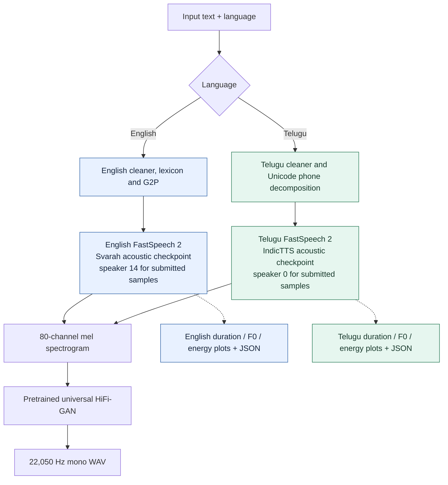

### Inside each FastSpeech 2 model

This diagram follows [the actual model](project/English/model/fastspeech2.py) and [variance-adaptor forward pass](project/English/model/modules.py). **Energy is predicted from pitch-conditioned states**, and both phone-level embeddings are added **before** duration expansion.

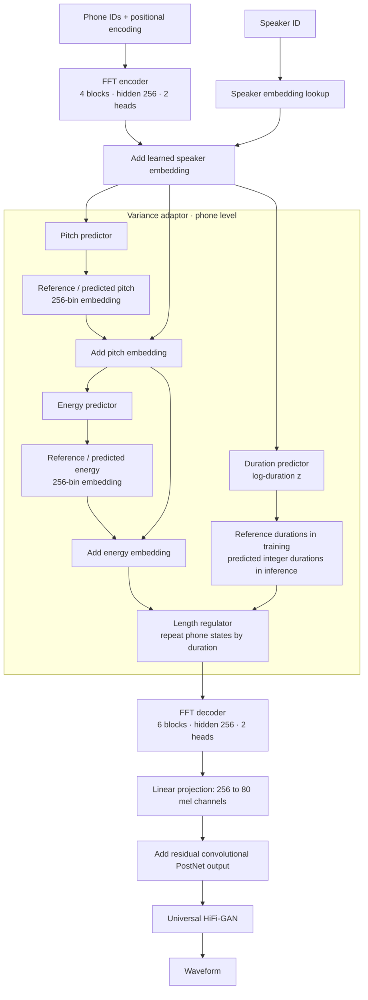

<details>
<summary><strong>Expand: training versus inference, loss equations and feature units</strong></summary>

**Training** supplies aligned reference durations and reference phone-level pitch/energy to the length regulator and embedding lookups. The three predictors still receive losses. **Inference** uses all three predictors without reference speech; the mel decoder operates in parallel after length expansion, followed by the separate neural vocoder.

At the default duration control of 1.0:

```text
z_i target = log(1 + reference_duration_i)
predicted_duration_i = max(round(exp(z_i) - 1), 0)
mel_frames = sum_i(predicted_duration_i)
duration_seconds = mel_frames × 256 / 22050

total_loss = L1(mel, reference_mel)
           + L1(postnet_mel, reference_mel)
           + MSE(log_duration, log(1 + reference_duration))
           + MSE(normalized_phone_pitch, pitch_target)
           + MSE(normalized_phone_energy, energy_target)
```

Padding masks remove padded phones/frames from the loss. The residual PostNet refines the projected mel, and inference passes the refined mel to HiFi-GAN. [Loss implementation](project/English/model/loss.py) · [vocoder loading and synthesis](project/English/utils/model.py).

- **Duration:** integer mel-frame expansion per phone at default controls; one frame is approximately 11.61 ms.
- **Pitch:** PyWorld F0 with interpolation and phone averaging, normalized for prediction and inverse-normalized to Hz in the result plots. This is a continuous phone-level estimate, including interpolated unvoiced spans; it is not an extracted F0 track from the generated WAV.
- **Energy:** phone average of the L2 norm of linear STFT magnitudes, normalized for training and restored to feature units for plotting. It is not dB SPL or a measured loudness score.
- **Controls:** `--pitch_control`, `--energy_control` and `--duration_control` default to 1.0. Pitch/energy controls multiply predictions in normalized feature space; a value of 1.2 is not guaranteed to raise physical F0 or loudness by exactly 20%.

</details>

<a id="implementation"></a>
## Reference reuse and language-specific modifications

Starting point: [ming024/FastSpeech2](https://github.com/ming024/FastSpeech2), reference commit recorded by the report as `d4e79eb52e8b01d24703b2dfc0385544092958f3`. The acoustic backbone, variance-predictor design, length regulator and HiFi-GAN integration are adapted from that implementation. Current source changes and historical trained weights should be assessed separately: code fixes do not retroactively regenerate the submitted models or audio.

| Component | English adaptation | Telugu adaptation | Source |
|---|---|---|---|
| Corpus preparation | Svarah loader, eight-field demographic profiles, duration filtering and split-specific reserves | IndicTTS loader using female/male source labels and split-specific reserves | [English preparation](project/English/prepare_data.py) · [Telugu preparation](project/Telugu/prepare_data.py) |
| Text normalization | ASCII normalization, lowercasing, abbreviations and numbers/time/date expansion | Telugu Unicode handling, Telugu digit/number/time/ordinal expansion | [English cleaner](project/English/text/cleaners.py) · [Telugu cleaner](project/Telugu/text/cleaners.py) |
| Phone frontend | Pronunciation lexicon lookup, `g2p_en` fallback for OOV words | Rule-based consonant/vowel decomposition; inherent vowel, dependent vowel signs, virama, anusvara and visarga | [English inference](project/English/inference.py) · [Telugu phones](project/Telugu/text/cleaners.py) |
| Symbol inventory | ARPAbet phones and stress symbols | Telugu phone inventory, with punctuation/silence handling | [English symbols](project/English/text/symbols.py) · [Telugu symbols](project/Telugu/text/symbols.py) |
| Alignments and features | Preserve interior silence/gaps; reject invalid timelines and unknown-speech `spn`; validate feature lengths | Same checks, with matching Telugu frontend/lexicon boundaries | [English preprocessor](project/English/preprocessor/preprocessor.py) · [Telugu preprocessor](project/Telugu/preprocessor/preprocessor.py) |
| Statistics | Selected-training-only pitch/energy means, standard deviations and quantization bounds in current preprocessing code | Same policy with independent Telugu statistics | Same preprocessor links above |
| Acoustic architecture | Speaker embedding + phone-level variance adaptor + mel/PostNet decoder | Same architecture with independent learned weights and language metadata | [English model](project/English/model/fastspeech2.py) · [Telugu model](project/Telugu/model/fastspeech2.py) |
| Adaptor corrections | Energy-control routing and device-aware length-regulator tensors | Same corrections | [English modules](project/English/model/modules.py) · [Telugu modules](project/Telugu/model/modules.py) |
| Training/inference outputs | CSV losses, loss plots, best-validation checkpoint tracking, explicit checkpoint/speaker selection, prediction JSON | Independent Telugu logs, outputs and checkpoint/speaker selection | [English training](project/English/train.py) · [Telugu training](project/Telugu/train.py) |

**Telugu example:** a consonant emits its base phone plus inherent `అ` unless a dependent vowel sign replaces that vowel or virama suppresses it. Vowel signs map to canonical independent vowel phones; consonant clusters/geminates require virama-aware handling. This is a deterministic phonemic approximation, with limitations for assimilation, allophones and loanwords. English first-pronunciation lexicon lookup can miss contextual noun/verb stress such as **conduct** in E2a versus E2b.

<details>
<summary><strong>Expand: how this implementation differs from the supplied FastSpeech 2 paper</strong></summary>

The supplied paper and the GitHub starting point are different references. As documented in report p. 3:

| Aspect | Supplied paper v8 | This project |
|---|---|---|
| Decoder depth | 4 FFT blocks | 6 FFT blocks |
| Pitch representation | Frame-level CWT representation | Direct phone-level F0 |
| Energy representation | Frame-level | Phone-level |
| Mel refinement | No added residual PostNet | Residual convolutional PostNet |
| Waveform synthesis | Parallel WaveGAN | Pretrained universal HiFi-GAN |

The project is an adaptation of the selected GitHub implementation, not an exact reproduction of every paper setting. See [report pp. 2–3](project/Report/Technical_Report.pdf#page=2).

</details>

<a id="datasets"></a>
## Datasets, subsampling and preprocessing

### Data used and retained split sizes

| Property | English | Telugu |
|---|---|---|
| Required dataset | [ai4bharat/Svarah](https://huggingface.co/datasets/ai4bharat/Svarah) | [SPRINGLab/IndicTTS_Telugu](https://huggingface.co/datasets/SPRINGLab/IndicTTS_Telugu) |
| Selection target | About 5h training + 1h validation | About 5h training + 1h validation |
| Reported retained training | 3,359 utterances · 5.000h | 2,164 utterances · 5.000h |
| Reported retained validation | 674 utterances · 1.001h | 421 utterances · 1.000h |
| Speaker/group metadata | 115 training demographic profiles; 114 represented in validation | 2 source voices: female and male |
| Submitted sample voice | ID 14, `svarah_spk_014` | ID 0, `te_female` |
| Default seed / clip filter | 42 / 1–20 s | 42 / 1–20 s |
| Prepared audio format | 22,050 Hz mono, 16-bit PCM | 22,050 Hz mono, 16-bit PCM |

Counts and retained hours above are **reported from recovered preprocessing summaries in report p. 4**, rather than recomputed from a full dataset included in this repository. English demographic profiles are derived from eight metadata fields and are **not verified unique individual speaker identities**. Both YAML files enable multi-speaker conditioning; Telugu is not a single-speaker training run.

### Deterministic selection and reserves

1. Resolve and record the dataset revision. Svarah preparation uses its `test` split as the source pool, then creates this assignment's own training/validation partitions; the source split name is not the assignment evaluation split.
2. Group English clips by the eight demographic fields; group Telugu clips by source voice. Shuffle within groups with seed 42, partition roughly 5:1, then shuffle candidate pools.
3. Filter invalid/empty transcripts and audio, retain clips in the 1–20 s interval, and deduplicate waveforms using SHA-1. Write resampled audio and normalized `.lab` transcripts.
4. Accumulate primary pools toward 5h/1h, plus separate default reserves of 0.75h training and 0.20h validation. Reserves replenish their own split after rejected alignments/features; they are not a shared cross-split pool.
5. Build pronunciation dictionaries, obtain compatible forced alignments, extract features and select retained clips toward the duration targets after trimming/rejection.

<a id="split-integrity"></a>
### Split integrity and evidence limits

The scripts enforce disjoint utterance IDs and check validation speaker coverage. The report states that recovered ID manifests have zero overlap, and source preparation statistics report zero audio-hash overlap. However, final waveform hashes are missing for **382 retained English reserve utterances** and **339 retained Telugu reserve utterances** (report p. 19). Consequently, complete final waveform-level overlap verification remains pending. The full manifests, recovered metadata and audit JSON referenced by the report are also not included in this GitHub snapshot.

### Alignment and feature extraction

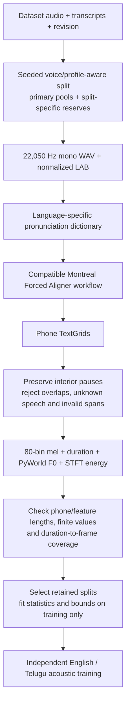

The preprocessing code reads phone TextGrids from `preprocessed_data/TextGrid/<speaker>/<utterance>.TextGrid`. It uses a 1,024-sample FFT/window and 256-sample hop, extracts 80 mel channels over 0–8,000 Hz, computes/interpolates PyWorld F0, and averages F0 and energy over phone durations. Current code preserves interior silence as `sp`, checks timelines before slicing, rejects unknown-speech `spn`, and fits normalization/bounds on selected training examples.

The report documents an earlier alignment-reader failure in which omitted interior silence shifted later phone/frame correspondence. It also records **82 historical Telugu target/frontend mismatches** (73 train, 9 validation), often around dotted initials. Current source checks are improvements for new preprocessing; the published checkpoint/audio artifacts remain historical evidence until regenerated and reviewed.

<a id="training-results"></a>
## Training configuration and results

<a id="training-configuration"></a>
### Committed configuration

These are settings in [English/config.yaml](project/English/config.yaml) and [Telugu/config.yaml](project/Telugu/config.yaml). They describe the checked-in defaults; a complete historical environment lock and final run provenance are not supplied.

| Setting | Both language configurations |
|---|---|
| Encoder / decoder | 4 / 6 FFT blocks; 256 hidden units; 2 attention heads |
| FFT convolution | Filter size 1,024; kernels `[9, 1]`; encoder/decoder dropout 0.2 |
| Variance predictor | Two convolution layers; 256 channels; kernel 3; dropout 0.5 |
| Pitch / energy | Phone-level, normalized; 256 linear quantization bins each |
| Speakers | Learned embedding enabled independently for each model |
| Acoustic features | 22,050 Hz; FFT/window 1,024; hop 256; 80 mel channels; 0–8,000 Hz |
| Optimizer | Adam; betas `(0.9, 0.98)`; epsilon `1e-9`; weight decay 0 |
| Batch / gradient policy | Batch 16; accumulation 1; gradient clipping 1.0 |
| Learning rate | Warmup 4,000 steps; anneal at 30k / 45k / 55k by factor 0.3 |
| Schedule | Total 60,000; log every 100; validate/synthesize every 1,000; regular save every 5,000 |
| Selection | Trainer tracks best total validation loss; submitted outputs select 8k English / 13k Telugu |

### Convergence measured from the submitted CSVs

| Measurement | English | Telugu |
|---|---:|---:|
| Logged training / validation rows | 600 / 60 | 600 / 60 |
| Final logged training step | 60,000 | 60,000 |
| First validation total (step 1,000) | 2.911052 | 2.405970 |
| **Minimum validation total** | **2.702820 at 8,000** | **1.965954 at 13,000** |
| Final validation total (step 60,000) | 2.735320 | 1.979367 |
| Final sampled training total | 0.921556 | 0.662709 |
| First-to-best validation decrease | 7.15% | 18.29% |

Source CSVs: English [training](project/Results/English/metrics/train_losses.csv) / [validation](project/Results/English/metrics/val_losses.csv); Telugu [training](project/Results/Telugu/metrics/train_losses.csv) / [validation](project/Results/Telugu/metrics/val_losses.csv).

Validation improves early and then plateaus, while training loss continues to fall. The persistent gap and slight post-minimum validation increase are consistent with overfitting and support selecting early checkpoints rather than automatically choosing step 60,000. Training CSV rows are sampled minibatch losses; validation values are aggregates. Their gap is descriptive, and totals across these two corpora are not directly comparable naturalness scores.

<details open>
<summary><strong>English: training and validation loss figures</strong></summary>


</details>

<details>
<summary><strong>Telugu: training and validation loss figures</strong></summary>


</details>

<a id="variance-gallery"></a>
## Explore the variance adaptor: ten sample panels

Expand a sample to view its **raw and normalized input, WAV, duration, F0 and energy plots, measured summary, and evaluation focus**. All thirty original PNGs are linked inside the panels. Prediction data: [English JSON](project/Results/English/variance_predictions_summary.json) / [Telugu JSON](project/Results/Telugu/variance_predictions_summary.json).

**How to interpret the plots:** the x-axis follows the model's phone tokens. Duration bars show frame expansion; the F0 and energy lines show inverse-normalized predictor outputs. A zero-duration token is omitted by the length regulator. A peak or pause is evidence of predicted prosody, not proof of correct pronunciation. Tokenwise ranges below are unweighted; consult the JSON for the full arrays and token labels.

<a id="sample-e1"></a>
<details>
<summary><strong>E1 · English · 5.817 s — audio, three plots and evaluation notes</strong></summary>

**[Play / download E1.wav](https://raw.githubusercontent.com/SandeshAwate6055/FastSpeech2-English-Telugu/main/project/Results/English/test_generated_audios/E1.wav)** · [Audio file](project/Results/English/test_generated_audios/E1.wav) · [Duration](project/Results/English/variance_adaptor_plots/duration/E1_duration.png) · [Pitch](project/Results/English/variance_adaptor_plots/pitch/E1_pitch.png) · [Energy](project/Results/English/variance_adaptor_plots/energy/E1_energy.png) · [Prediction JSON](project/Results/English/variance_predictions_summary.json)

**Submitted raw input** (spaces preserved):

```text
The antidisestablishmentarianism movement gained considerable momentum during the parliamentary proceedings.
```

**Saved normalized input:**

```text
the antidisestablishmentarianism movement gained considerable momentum during the parliamentary proceedings
```

| Saved measurement | Value |
|---|---|
| Acoustic checkpoint / speaker | 8,000 / 14 |
| Phone tokens / total mel frames | 85 / 501 |
| WAV duration / zero-duration tokens | 5.817 s / 1 |
| Explicit silence-token expansion | 0 frames (0.000 s) |
| Predicted phone F0 range | 93.11–174.44 Hz |
| Predicted phone energy range | 13.95–149.04 STFT-magnitude units |

**Analysis / listening focus:** Rare long-word pronunciation and sentence completeness. One saved phone has zero predicted duration, so inspect whether any audible segment is lost; the array alone does not establish an omitted word.

**Listening status:** pending, as recorded in the technical report. No pronunciation or naturalness judgment is inferred from these measurements.

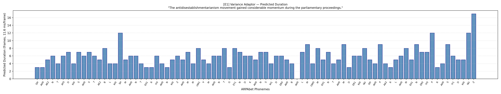

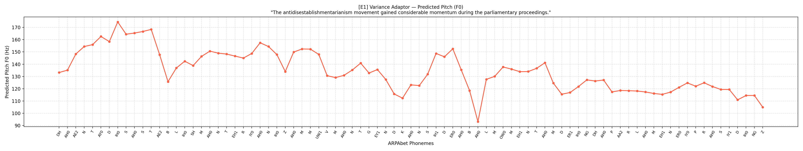

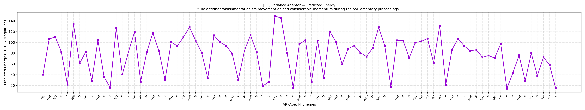

[Return to all ten audio links](#audio) · [Gallery guide](#variance-gallery)

</details>

<a id="sample-e2a"></a>
<details>
<summary><strong>E2a · English · 3.286 s — audio, three plots and evaluation notes</strong></summary>

**[Play / download E2a.wav](https://raw.githubusercontent.com/SandeshAwate6055/FastSpeech2-English-Telugu/main/project/Results/English/test_generated_audios/E2a.wav)** · [Audio file](project/Results/English/test_generated_audios/E2a.wav) · [Duration](project/Results/English/variance_adaptor_plots/duration/E2a_duration.png) · [Pitch](project/Results/English/variance_adaptor_plots/pitch/E2a_pitch.png) · [Energy](project/Results/English/variance_adaptor_plots/energy/E2a_energy.png) · [Prediction JSON](project/Results/English/variance_predictions_summary.json)

**Submitted raw input** (spaces preserved):

```text
The orchestra's conduct during the ceremony was praised by the audience.
```

**Saved normalized input:**

```text
the orchestra's conduct during the ceremony was praised by the audience
```

| Saved measurement | Value |
|---|---|
| Acoustic checkpoint / speaker | 8,000 / 14 |
| Phone tokens / total mel frames | 50 / 283 |
| WAV duration / zero-duration tokens | 3.286 s / 0 |
| Explicit silence-token expansion | 0 frames (0.000 s) |
| Predicted phone F0 range | 109.06–189.23 Hz |
| Predicted phone energy range | 7.16–138.10 STFT-magnitude units |

**Analysis / listening focus:** Compare noun-context **conduct** against verb-context E2b. The first-pronunciation lexicon can flatten stress differences; a pitch peak alone cannot establish correct lexical stress.

**Listening status:** pending, as recorded in the technical report. No pronunciation or naturalness judgment is inferred from these measurements.

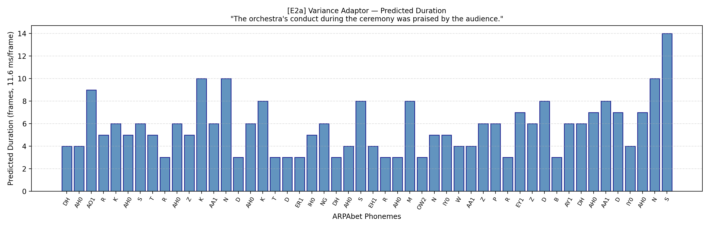

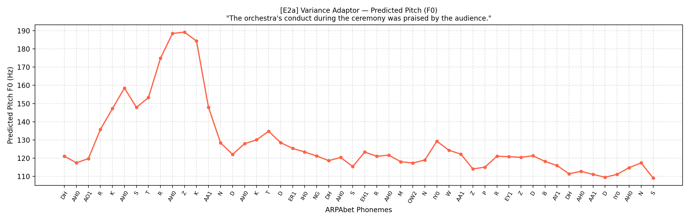

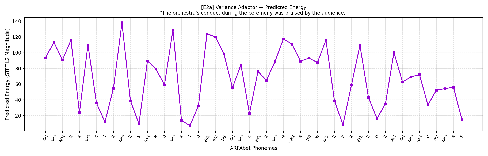

[Return to all ten audio links](#audio) · [Gallery guide](#variance-gallery)

</details>

<a id="sample-e2b"></a>
<details>
<summary><strong>E2b · English · 3.913 s — audio, three plots and evaluation notes</strong></summary>

**[Play / download E2b.wav](https://raw.githubusercontent.com/SandeshAwate6055/FastSpeech2-English-Telugu/main/project/Results/English/test_generated_audios/E2b.wav)** · [Audio file](project/Results/English/test_generated_audios/E2b.wav) · [Duration](project/Results/English/variance_adaptor_plots/duration/E2b_duration.png) · [Pitch](project/Results/English/variance_adaptor_plots/pitch/E2b_pitch.png) · [Energy](project/Results/English/variance_adaptor_plots/energy/E2b_energy.png) · [Prediction JSON](project/Results/English/variance_predictions_summary.json)

**Submitted raw input** (spaces preserved):

```text
The researchers will conduct an experiment to evaluate the proposed method.
```

**Saved normalized input:**

```text
the researchers will conduct an experiment to evaluate the proposed method
```

| Saved measurement | Value |
|---|---|
| Acoustic checkpoint / speaker | 8,000 / 14 |
| Phone tokens / total mel frames | 56 / 337 |
| WAV duration / zero-duration tokens | 3.913 s / 0 |
| Explicit silence-token expansion | 0 frames (0.000 s) |
| Predicted phone F0 range | 112.90–178.28 Hz |
| Predicted phone energy range | 9.44–121.10 STFT-magnitude units |

**Analysis / listening focus:** Compare verb-context **conduct** with E2a while checking the complete sentence. Contextual pronunciation and stress still need listening assessment.

**Listening status:** pending, as recorded in the technical report. No pronunciation or naturalness judgment is inferred from these measurements.

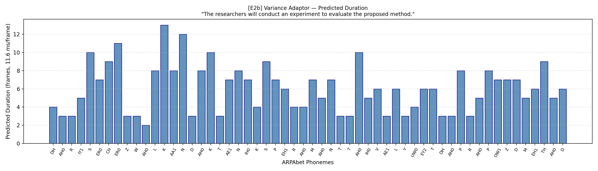

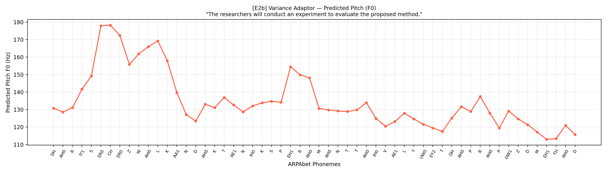

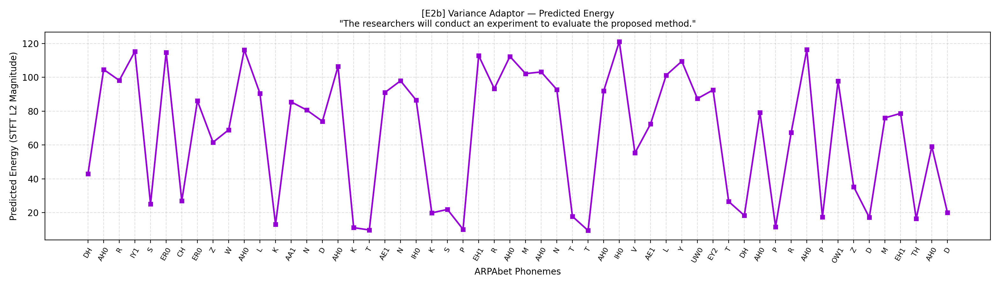

[Return to all ten audio links](#audio) · [Gallery guide](#variance-gallery)

</details>

<a id="sample-e3"></a>
<details>
<summary><strong>E3 · English · 2.519 s — audio, three plots and evaluation notes</strong></summary>

**[Play / download E3.wav](https://raw.githubusercontent.com/SandeshAwate6055/FastSpeech2-English-Telugu/main/project/Results/English/test_generated_audios/E3.wav)** · [Audio file](project/Results/English/test_generated_audios/E3.wav) · [Duration](project/Results/English/variance_adaptor_plots/duration/E3_duration.png) · [Pitch](project/Results/English/variance_adaptor_plots/pitch/E3_pitch.png) · [Energy](project/Results/English/variance_adaptor_plots/energy/E3_energy.png) · [Prediction JSON](project/Results/English/variance_predictions_summary.json)

**Submitted raw input** (spaces preserved):

```text
The rhyth  m of the orchestra changed unexpectedly.
```

**Saved normalized input:**

```text
the rhyth m of the orchestra changed unexpectedly
```

| Saved measurement | Value |
|---|---|
| Acoustic checkpoint / speaker | 8,000 / 14 |
| Phone tokens / total mel frames | 37 / 217 |
| WAV duration / zero-duration tokens | 2.519 s / 0 |
| Explicit silence-token expansion | 0 frames (0.000 s) |
| Predicted phone F0 range | 108.71–143.44 Hz |
| Predicted phone energy range | 6.44–113.02 STFT-magnitude units |

**Analysis / listening focus:** The source contains the broken token **`rhyth  m`**. Normalization collapses repeated whitespace but leaves a word boundary; inspect pronunciation of the split word. Its predicted F0 range is narrower than the other English samples.

**Listening status:** pending, as recorded in the technical report. No pronunciation or naturalness judgment is inferred from these measurements.

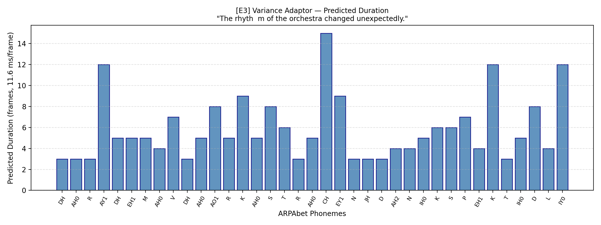

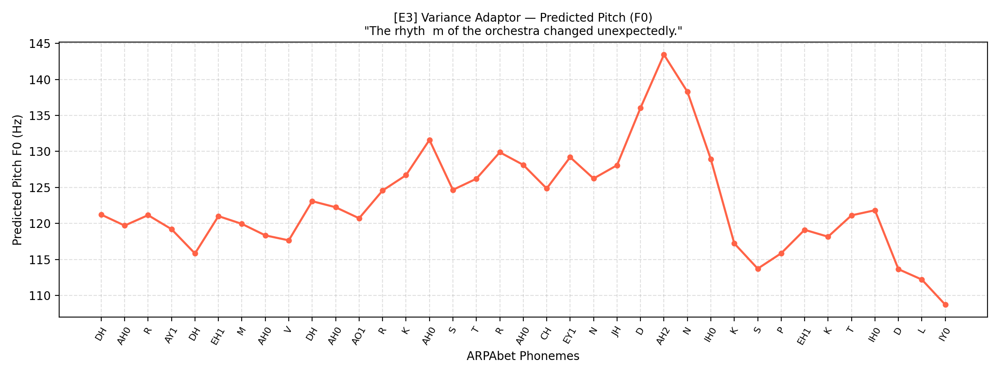

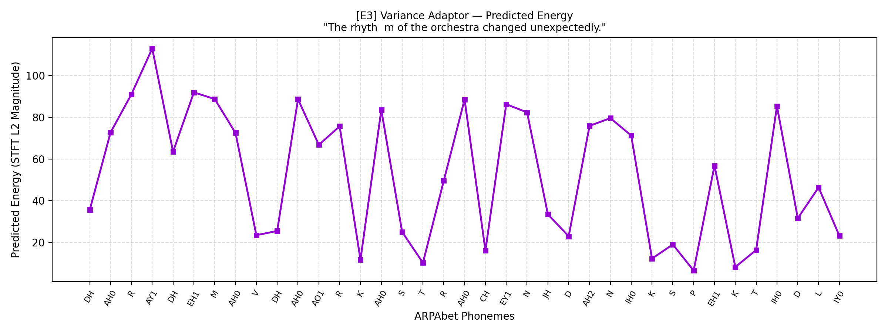

[Return to all ten audio links](#audio) · [Gallery guide](#variance-gallery)

</details>

<a id="sample-e4"></a>
<details>
<summary><strong>E4 · English · 6.525 s — audio, three plots and evaluation notes</strong></summary>

**[Play / download E4.wav](https://raw.githubusercontent.com/SandeshAwate6055/FastSpeech2-English-Telugu/main/project/Results/English/test_generated_audios/E4.wav)** · [Audio file](project/Results/English/test_generated_audios/E4.wav) · [Duration](project/Results/English/variance_adaptor_plots/duration/E4_duration.png) · [Pitch](project/Results/English/variance_adaptor_plots/pitch/E4_pitch.png) · [Energy](project/Results/English/variance_adaptor_plots/energy/E4_energy.png) · [Prediction JSON](project/Results/English/variance_predictions_summary.json)

**Submitted raw input** (spaces preserved):

```text
The meeting will start at 10:45 AM on 12 November 2026, so andaroo should arrive on time.
```

**Saved normalized input:**

```text
the meeting will start at ten forty five a m on twelve november twenty twenty-six, so andaroo should arrive on time
```

| Saved measurement | Value |
|---|---|
| Acoustic checkpoint / speaker | 8,000 / 14 |
| Phone tokens / total mel frames | 80 / 562 |
| WAV duration / zero-duration tokens | 6.525 s / 0 |
| Explicit silence-token expansion | 76 frames (0.882 s) |
| Predicted phone F0 range | 114.78–196.37 Hz |
| Predicted phone energy range | 5.23–139.49 STFT-magnitude units |

**Analysis / listening focus:** Inspect spoken **10:45 AM**, **12 November 2026**, the loanword **andaroo**, sentence completeness and comma phrasing. Normalization is observable below; correct articulation is not established by valid phone IDs.

**Listening status:** pending, as recorded in the technical report. No pronunciation or naturalness judgment is inferred from these measurements.

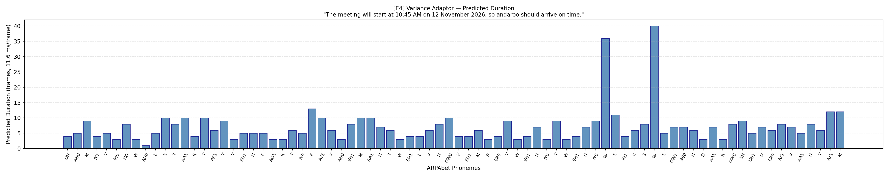

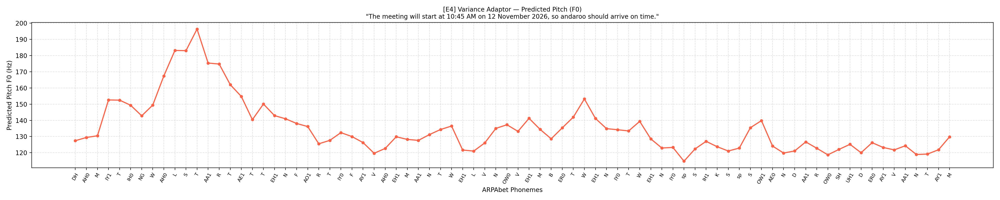

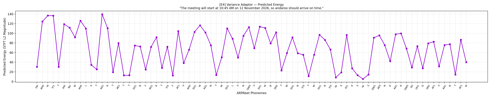

[Return to all ten audio links](#audio) · [Gallery guide](#variance-gallery)

</details>

<a id="sample-t1"></a>
<details>
<summary><strong>T1 · Telugu · 5.236 s — audio, three plots and evaluation notes</strong></summary>

**[Play / download T1.wav](https://raw.githubusercontent.com/SandeshAwate6055/FastSpeech2-English-Telugu/main/project/Results/Telugu/test_generated_audios/T1.wav)** · [Audio file](project/Results/Telugu/test_generated_audios/T1.wav) · [Duration](project/Results/Telugu/variance_adaptor_plots/duration/T1_duration.png) · [Pitch](project/Results/Telugu/variance_adaptor_plots/pitch/T1_pitch.png) · [Energy](project/Results/Telugu/variance_adaptor_plots/energy/T1_energy.png) · [Prediction JSON](project/Results/Telugu/variance_predictions_summary.json)

**Submitted raw input** (spaces preserved):

```text
న్యూరోఫార్మకోలాజికల్ పరిశోధనలో నూతన ఔషధాల ప్రభావాన్ని విశ్లేషించారు.
```

**Saved normalized input:**

```text
న్యూరోఫార్మకోలాజికల్ పరిశోధనలో నూతన ఔషధాల ప్రభావాన్ని విశ్లేషించారు.
```

| Saved measurement | Value |
|---|---|
| Acoustic checkpoint / speaker | 13,000 / 0 |
| Phone tokens / total mel frames | 66 / 451 |
| WAV duration / zero-duration tokens | 5.236 s / 0 |
| Explicit silence-token expansion | 0 frames (0.000 s) |
| Predicted phone F0 range | 155.40–321.95 Hz |
| Predicted phone energy range | 8.16–140.61 STFT-magnitude units |

**Analysis / listening focus:** Inspect the long technical word **న్యూరోఫార్మకోలాజికల్**, consonant clusters, vowel length and sentence completeness. The Unicode decomposition is an approximation rather than proof of a correct pronunciation.

**Listening status:** pending, as recorded in the technical report. No pronunciation or naturalness judgment is inferred from these measurements.

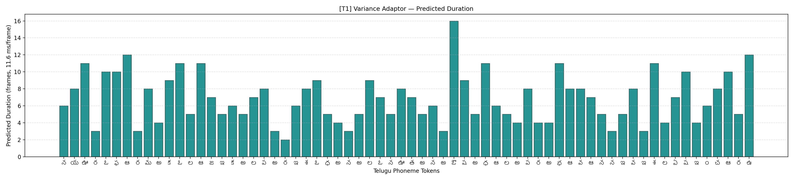

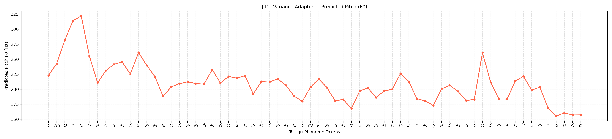

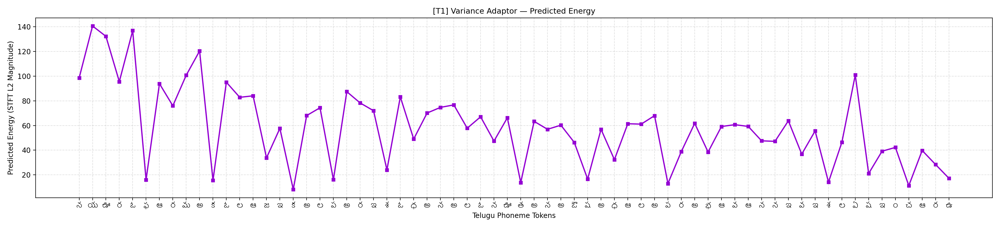

[Return to all ten audio links](#audio) · [Gallery guide](#variance-gallery)

</details>

<a id="sample-t2a"></a>
<details>
<summary><strong>T2a · Telugu · 2.577 s — audio, three plots and evaluation notes</strong></summary>

**[Play / download T2a.wav](https://raw.githubusercontent.com/SandeshAwate6055/FastSpeech2-English-Telugu/main/project/Results/Telugu/test_generated_audios/T2a.wav)** · [Audio file](project/Results/Telugu/test_generated_audios/T2a.wav) · [Duration](project/Results/Telugu/variance_adaptor_plots/duration/T2a_duration.png) · [Pitch](project/Results/Telugu/variance_adaptor_plots/pitch/T2a_pitch.png) · [Energy](project/Results/Telugu/variance_adaptor_plots/energy/T2a_energy.png) · [Prediction JSON](project/Results/Telugu/variance_predictions_summary.json)

**Submitted raw input** (spaces preserved):

```text
తాడుపై అతని పట్టు చాలా బలంగా ఉంది.
```

**Saved normalized input:**

```text
తాడుపై అతని పట్టు చాలా బలంగా ఉంది.
```

| Saved measurement | Value |
|---|---|
| Acoustic checkpoint / speaker | 13,000 / 0 |
| Phone tokens / total mel frames | 31 / 222 |
| WAV duration / zero-duration tokens | 2.577 s / 0 |
| Explicit silence-token expansion | 0 frames (0.000 s) |
| Predicted phone F0 range | 153.51–329.22 Hz |
| Predicted phone energy range | 4.07–130.15 STFT-magnitude units |

**Analysis / listening focus:** Compare **పట్టు** in the grip/hold context with T2b in the silk context. Inspect geminate realization, vowel timing and phrase contour without assuming semantic understanding from the same phone sequence.

**Listening status:** pending, as recorded in the technical report. No pronunciation or naturalness judgment is inferred from these measurements.

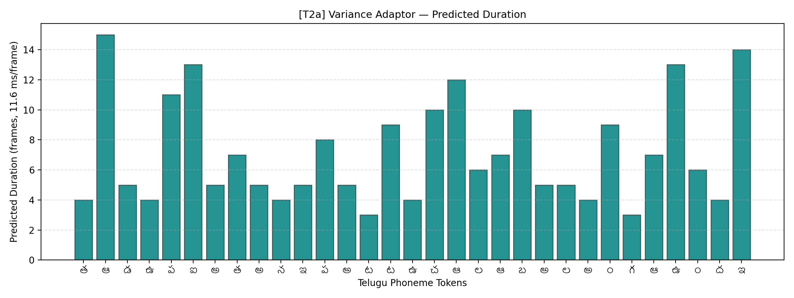

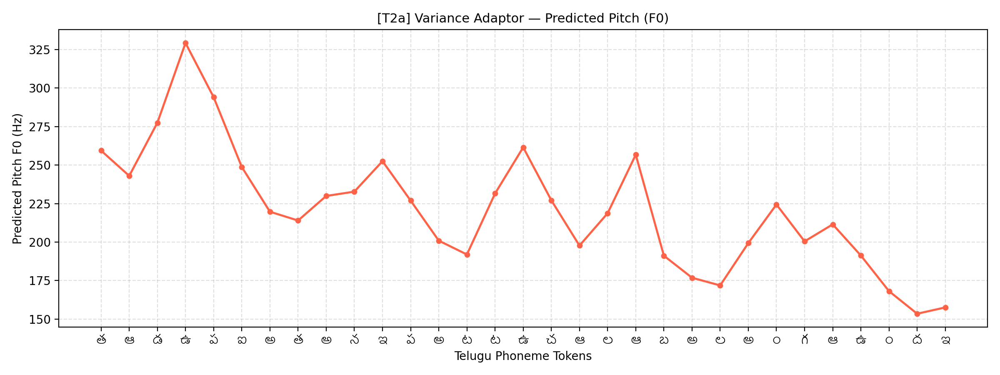

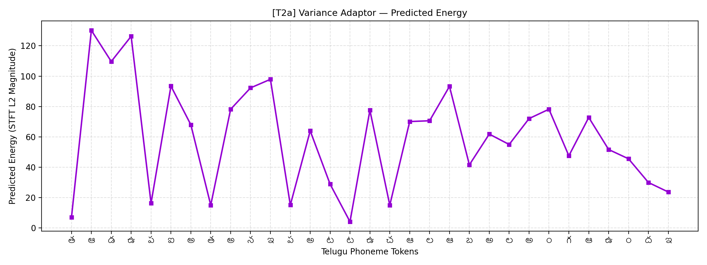

[Return to all ten audio links](#audio) · [Gallery guide](#variance-gallery)

</details>

<a id="sample-t2b"></a>
<details>
<summary><strong>T2b · Telugu · 2.740 s — audio, three plots and evaluation notes</strong></summary>

**[Play / download T2b.wav](https://raw.githubusercontent.com/SandeshAwate6055/FastSpeech2-English-Telugu/main/project/Results/Telugu/test_generated_audios/T2b.wav)** · [Audio file](project/Results/Telugu/test_generated_audios/T2b.wav) · [Duration](project/Results/Telugu/variance_adaptor_plots/duration/T2b_duration.png) · [Pitch](project/Results/Telugu/variance_adaptor_plots/pitch/T2b_pitch.png) · [Energy](project/Results/Telugu/variance_adaptor_plots/energy/T2b_energy.png) · [Prediction JSON](project/Results/Telugu/variance_predictions_summary.json)

**Submitted raw input** (spaces preserved):

```text
ఆమె పట్టు చీరను ధరించి వేడుకకు వచ్చింది.
```

**Saved normalized input:**

```text
ఆమె పట్టు చీరను ధరించి వేడుకకు వచ్చింది.
```

| Saved measurement | Value |
|---|---|
| Acoustic checkpoint / speaker | 13,000 / 0 |
| Phone tokens / total mel frames | 37 / 236 |
| WAV duration / zero-duration tokens | 2.740 s / 0 |
| Explicit silence-token expansion | 0 frames (0.000 s) |
| Predicted phone F0 range | 158.50–307.49 Hz |
| Predicted phone energy range | 5.65–133.13 STFT-magnitude units |

**Analysis / listening focus:** Compare the silk-context **పట్టు** with T2a, including timing and stress/prosody. Phone-level curves alone do not demonstrate a perceptual distinction.

**Listening status:** pending, as recorded in the technical report. No pronunciation or naturalness judgment is inferred from these measurements.

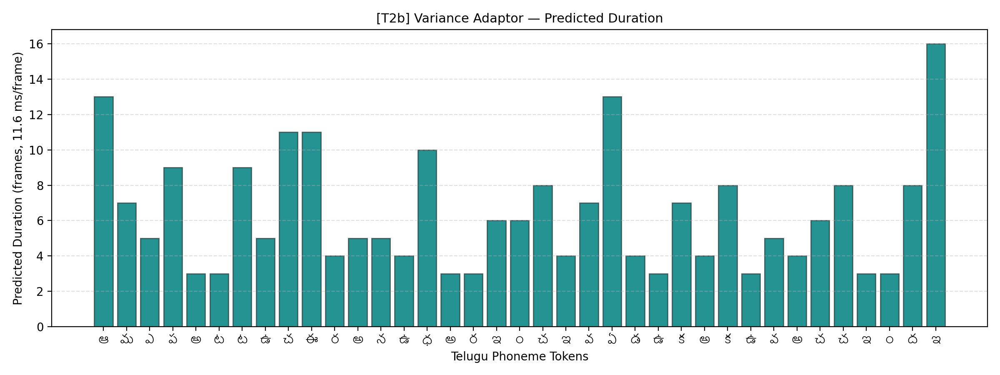

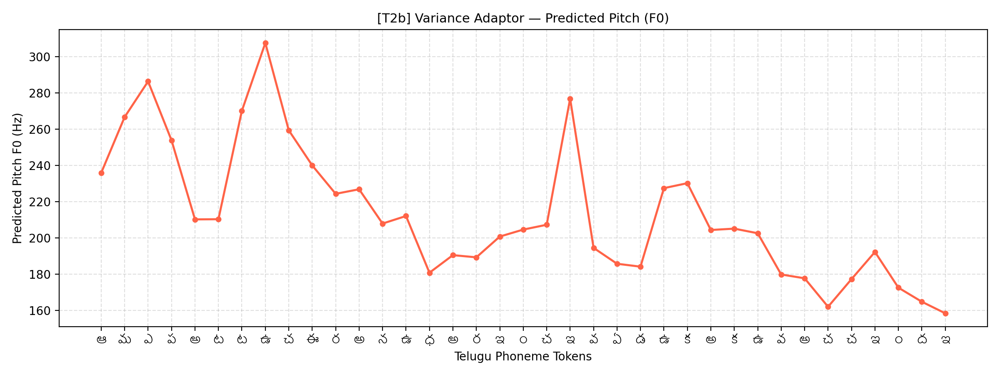

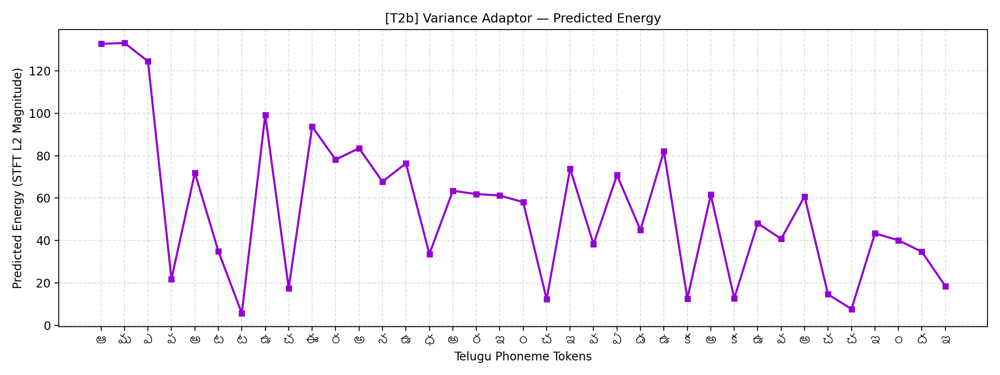

[Return to all ten audio links](#audio) · [Gallery guide](#variance-gallery)

</details>

<a id="sample-t3"></a>
<details>
<summary><strong>T3 · Telugu · 2.334 s — audio, three plots and evaluation notes</strong></summary>

**[Play / download T3.wav](https://raw.githubusercontent.com/SandeshAwate6055/FastSpeech2-English-Telugu/main/project/Results/Telugu/test_generated_audios/T3.wav)** · [Audio file](project/Results/Telugu/test_generated_audios/T3.wav) · [Duration](project/Results/Telugu/variance_adaptor_plots/duration/T3_duration.png) · [Pitch](project/Results/Telugu/variance_adaptor_plots/pitch/T3_pitch.png) · [Energy](project/Results/Telugu/variance_adaptor_plots/energy/T3_energy.png) · [Prediction JSON](project/Results/Telugu/variance_predictions_summary.json)

**Submitted raw input** (spaces preserved):

```text
పులి అడ  విలో నిశ్శబ్దంగా నడిచింది.
```

**Saved normalized input:**

```text
పులి అడ విలో నిశ్శబ్దంగా నడిచింది.
```

| Saved measurement | Value |
|---|---|
| Acoustic checkpoint / speaker | 13,000 / 0 |
| Phone tokens / total mel frames | 31 / 201 |
| WAV duration / zero-duration tokens | 2.334 s / 0 |
| Explicit silence-token expansion | 0 frames (0.000 s) |
| Predicted phone F0 range | 155.94–334.33 Hz |
| Predicted phone energy range | 5.64–115.50 STFT-magnitude units |

**Analysis / listening focus:** The source preserves **`అడ  విలో`** as a broken word. Inspect the resulting word boundary and intelligibility; source double spaces do not guarantee a duration pause.

**Listening status:** pending, as recorded in the technical report. No pronunciation or naturalness judgment is inferred from these measurements.

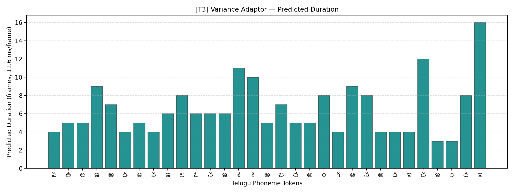

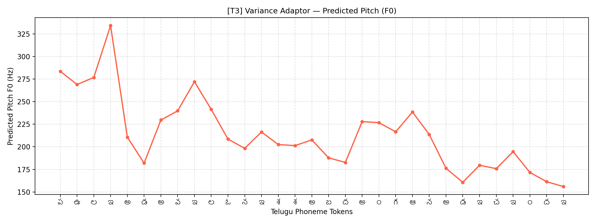

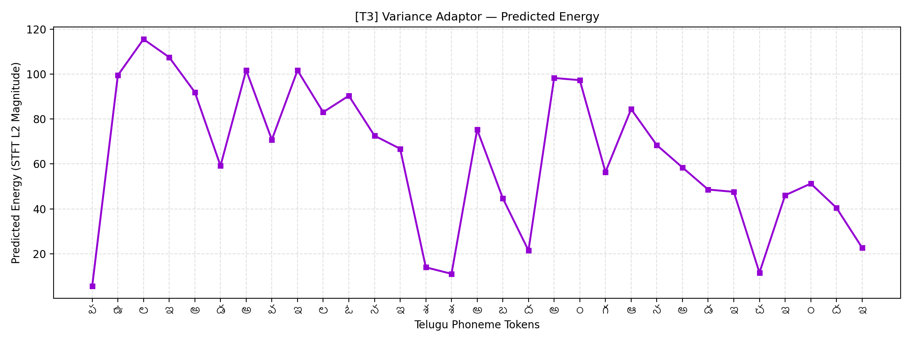

[Return to all ten audio links](#audio) · [Gallery guide](#variance-gallery)

</details>

<a id="sample-t4"></a>
<details>
<summary><strong>T4 · Telugu · 8.998 s — audio, three plots and evaluation notes</strong></summary>

**[Play / download T4.wav](https://raw.githubusercontent.com/SandeshAwate6055/FastSpeech2-English-Telugu/main/project/Results/Telugu/test_generated_audios/T4.wav)** · [Audio file](project/Results/Telugu/test_generated_audios/T4.wav) · [Duration](project/Results/Telugu/variance_adaptor_plots/duration/T4_duration.png) · [Pitch](project/Results/Telugu/variance_adaptor_plots/pitch/T4_pitch.png) · [Energy](project/Results/Telugu/variance_adaptor_plots/energy/T4_energy.png) · [Prediction JSON](project/Results/Telugu/variance_predictions_summary.json)

**Submitted raw input** (spaces preserved):

```text
ఈ సమావేశం 2026 నవంబర్ 12వ తేదీ ఉదయం 10:45 గంటలకు ప్రారంభమవుతుంది, సమయానికి సిద్ధంగా ఉంచండి.
```

**Saved normalized input:**

```text
ఈ సమావేశం రెండు వేల ఇరవై ఆరు నవంబర్ పన్నెండవ తేదీ ఉదయం పది నలభై ఐదు గంటలకు ప్రారంభమవుతుంది, సమయానికి సిద్ధంగా ఉంచండి.
```

| Saved measurement | Value |
|---|---|
| Acoustic checkpoint / speaker | 13,000 / 0 |
| Phone tokens / total mel frames | 120 / 775 |
| WAV duration / zero-duration tokens | 8.998 s / 0 |
| Explicit silence-token expansion | 52 frames (0.604 s) |
| Predicted phone F0 range | 160.12–289.32 Hz |
| Predicted phone energy range | 1.38–114.45 STFT-magnitude units |

**Analysis / listening focus:** Inspect spoken **2026**, ordinal **12వ**, time **10:45**, the comma pause and completeness. This is the longest saved Telugu output, with 120 phone tokens and 775 mel frames.

**Listening status:** pending, as recorded in the technical report. No pronunciation or naturalness judgment is inferred from these measurements.

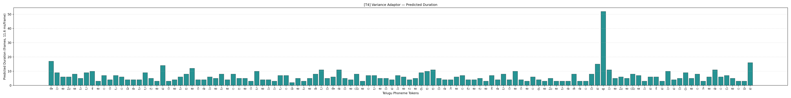

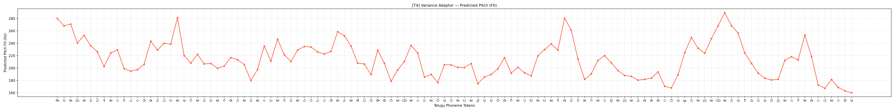

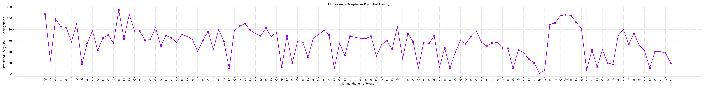

[Return to all ten audio links](#audio) · [Gallery guide](#variance-gallery)

</details>


<a id="checkpoints"></a>
## Checkpoints, downloads and integrity

**[Open the main Drive artifact folder](https://drive.google.com/drive/folders/1WsR1NHhzpkLvk3V0g8X3Jy-xsXNlsYHf?usp=sharing).** Acoustic checkpoints are hosted externally because they are too large for ordinary GitHub file storage. The table preserves the owner-supplied links and hashes from the language checkpoint READMEs; this documentation update did not download the Drive files or revalidate public sharing.

| Language | Selected checkpoint | Submitted speaker | Size | Download | Destination after cloning |
|---|---|---|---:|---|---|
| English | `8000.pth.tar` · best logged validation at 8k | 14 · `svarah_spk_014` | 420,505,334 bytes (420.5 MB) | [Drive file](https://drive.google.com/file/d/1asQbbLU4y9qPAHd8Jvu2T1G-5VES6X7P/view) · [Direct download](https://drive.google.com/uc?export=download&id=1asQbbLU4y9qPAHd8Jvu2T1G-5VES6X7P) | `project/English/checkpoints/8000.pth.tar` |
| Telugu | `13000.pth.tar` · best logged validation at 13k | 0 · `te_female` | 420,944,630 bytes (420.9 MB) | [Drive file](https://drive.google.com/file/d/1loNuZ9gRVLTobXHzzwZGsDe8KkB_FB-p/view) · [Direct download](https://drive.google.com/uc?export=download&id=1loNuZ9gRVLTobXHzzwZGsDe8KkB_FB-p) | `project/Telugu/checkpoints/13000.pth.tar` |

<details>
<summary><strong>Expand: SHA-256 hashes and checkpoint download commands</strong></summary>

```text
English 8000.pth.tar
b50f0558474eab89e95e8079df23cb3c364e339ce00fe6d88316beb4b86ff49a

Telugu 13000.pth.tar
49902507629887721818ec180dac2b419609f6c7a9e601c6d767a11233d1baa1
```

From the repository root:

```bash
python -m pip install gdown
gdown 1asQbbLU4y9qPAHd8Jvu2T1G-5VES6X7P -O project/English/checkpoints/8000.pth.tar
gdown 1loNuZ9gRVLTobXHzzwZGsDe8KkB_FB-p -O project/Telugu/checkpoints/13000.pth.tar
```

Verify against the hashes above with `sha256sum` (Linux/Colab) or `Get-FileHash -Algorithm SHA256` (PowerShell). Drive may require a browser confirmation or encounter download quotas.

Original provenance: [English checkpoint README](project/English/checkpoints/README.md) · [Telugu checkpoint README](project/Telugu/checkpoints/README.md).

</details>

**A checkpoint alone is insufficient for inference.** Each model also needs its original `preprocessed_data/speakers.json`, `preprocessed_data/stats.json`, matching symbol/frontend setup, the appropriate lexicon and `hifigan/generator_universal.pth.tar`. The vocoder code and configuration are checked in; pretrained generator weights and acoustic feature metadata are not. Preserve the original speaker-ID mapping and statistics when restoring bundles.

<a id="reproducibility"></a>
## Reproducibility and run commands

### Current execution prerequisites

The saved outputs can be evaluated immediately through the links above. Running the pipeline from a fresh clone has the following **observed packaging blockers**, which a README edit does not repair:

| Observed issue | Why it matters / required restoration |
|---|---|
| Language `preprocess.py`, `train.py` and `inference.py` import `run_support` from `project/tools/`, but that directory is absent | Restore the matching shared helpers, including `run_support.py` and the provenance/feature-validation support used by training. |
| Colab references `tools/restore_artifacts.py`, `tools/colab_pipeline.py` and `tools/probe_audio.py`, none of which is included | Restore the notebook's support scripts before running its evaluation or training branches. |
| Colab also reads `model_artifacts.json` and `Results/test_sentences.json`, neither of which is included | Restore the matching artifact registry and exact-text manifest with paths adjusted for the current repository layout. |
| Notebook uses root-level `English/`, `Telugu/` and `Results/`; checked-in code is under `project/` | Separate the checkout root from the project execution root and adjust every referenced path consistently. Both notebook copies currently have this issue. |
| Matching statistics, speaker maps, full preprocessing metadata and pretrained vocoder weights are external/omitted | Obtain complete language bundles, verify checksums and restore them to the paths expected by each YAML. |
| Requirements specify lower bounds, rather than an exact environment lock | Record tested Python/PyTorch/CUDA/library versions when reproducing; MFA is a separate alignment dependency for training. |

The commands below use **actual CLI option names from the checked-in scripts** and the correct `project/` layout. They are instructions for a **fully restored environment**, not a claim that fresh-clone inference or retraining was executed during this documentation update. The old `--checkpoint_path` and `--output_path` examples are replaced by supported options such as `--ckpt_file` and `--result_path`.

### 1. Clone and install the acoustic dependencies

The examples use Bash syntax, suitable for Linux/Colab. In PowerShell, use single-line commands or PowerShell continuation syntax.

```bash
git clone https://github.com/SandeshAwate6055/FastSpeech2-English-Telugu.git
cd FastSpeech2-English-Telugu
python -m pip install -r project/requirements.txt
python -c "import nltk; [nltk.download(n) for n in ['averaged_perceptron_tagger', 'averaged_perceptron_tagger_eng', 'cmudict']]"
```

Install compatible PyTorch/torchaudio for your GPU environment. Training requires a compatible MFA environment/acoustic model and dictionary. Svarah access may require Hugging Face dataset approval and `HF_TOKEN`; credentials do not belong in this README or repository.

### 2. Restore model bundles

Download the [selected acoustic weights](#checkpoints), the matching statistics/speaker metadata, and universal HiFi-GAN weights. Expected paths include:

```text
project/English/checkpoints/8000.pth.tar
project/Telugu/checkpoints/13000.pth.tar
project/<Language>/preprocessed_data/stats.json
project/<Language>/preprocessed_data/speakers.json
project/<Language>/hifigan/generator_universal.pth.tar
project/tools/run_support.py                  # omitted shared helper; restoration required
```

Keep metadata coupled to its checkpoint. A newly generated `speakers.json` or newly fitted `stats.json` can be incompatible with saved weights even if dimensions appear valid.

### 3. Generate all five English samples

Run from the cloned repository root after restoring the prerequisites. Omitting `--text` selects the five assignment sentences built into the inference script.

```bash
cd project/English
python inference.py --config config.yaml \
  --ckpt_file checkpoints/8000.pth.tar \
  --speaker_id 14 \
  --result_path ../Results/reproduced/English
```

### 4. Generate all five Telugu samples

Continue from `project/English`:

```bash
cd ../Telugu
python inference.py --config config.yaml \
  --ckpt_file checkpoints/13000.pth.tar \
  --speaker_id 0 \
  --result_path ../Results/reproduced/Telugu
```

Each language run writes five WAVs, fifteen variance PNGs and `variance_predictions_summary.json` into its selected result directory. The examples preserve the committed outputs. Choose a new directory when repeating a run; existing summaries cause the script to stop unless `--overwrite` is explicitly requested. An explicit checkpoint avoids the script's automatic latest-step selection.

<details>
<summary><strong>Expand: a single custom sentence and prosody controls</strong></summary>

From `project/English`, in a fully restored environment:

```bash
python inference.py --config config.yaml \
  --ckpt_file checkpoints/8000.pth.tar --speaker_id 14 \
  --text "This is a custom synthesis example." --sample_id custom \
  --pitch_control 1.0 --energy_control 1.0 --duration_control 1.0 \
  --result_path ../Results/custom/English
```

This creates a new custom output; it does not substitute for any mandatory test sentence. Phone normalization and controls affect the synthesized result. The submitted examples use the fixed IDs, texts, speakers and checkpoint steps listed above.

</details>

### 5. Prepare, align, preprocess and train new models

Preparation, forced alignment and feature extraction are separate stages. **`prepare_data.py` does not create the phone TextGrids by itself.** Before `preprocess.py`, align the prepared WAV/LAB files with the matching pronunciation dictionary and compatible MFA model, then place phone TextGrids under the configured `preprocessed_data/TextGrid/<speaker>/` hierarchy. For a new Telugu aligner, fit using training/reserve-training data, keeping validation audio out of aligner fitting. The notebook describes the intended automation, but its omitted helpers must first be restored.

After choosing fresh paths and restoring those helpers, the core commands from each language directory are:

```bash
# From project/English:
python prepare_data.py --raw_dir raw_data --train_hours 5.0 --val_hours 1.0 --seed 42
# Required intermediate stage: obtain compatible phone-level MFA TextGrids.
python preprocess.py --config config.yaml
# Required review: validate features, vocoder reconstruction and held-out synthesis.
python train.py --config config.yaml --total_step 60000

# From project/Telugu, run the same three language-local commands
# after independent Telugu preparation/alignment and feature validation.
```

Do not reuse historical alignments with newly selected or changed waveforms/transcripts without verifying correspondence. Keep train/validation manifests, dataset revisions, hashes, statistics and speaker maps with the experiment. The trainer calls provenance/feature-validation checks through the omitted shared helpers, so those checks are prerequisites rather than steps to bypass.

### Colab workflow guide

The [root notebook](FastSpeech2_Colab.ipynb) and [project copy](project/FastSpeech2_Colab.ipynb) currently contain the same workflow. Its default is `MODE = "evaluate"`; `MODE = "train"` describes a fresh experiment. After the packaging/path issues above are repaired, its eight sections are intended to cover:

1. Drive mount, dependencies, checkout and explicit experiment mode.
2. English bundle restoration or fresh preparation/alignment.
3. Telugu bundle restoration or fresh preparation/alignment.
4. Real-mel vocoder checks and a 64-clip overfit diagnostic.
5. English 5,000-step held-out pilot.
6. Telugu 5,000-step held-out pilot.
7. Held-out checkpoint probes and explicitly enabled full training.
8. Ten test outputs, playback, consistency checks and packaging.

<a id="files"></a>
## Repository structure and source index

```text
FastSpeech2-English-Telugu/
├── README.md                         # evaluator guide (this page)
├── FastSpeech2_Assignment.pdf         # unchanged source specification
├── FastSpeech2_Colab.ipynb            # notebook entry point
├── requirements.txt
└── project/
    ├── English/
    │   ├── prepare_data.py
    │   ├── preprocess.py
    │   ├── train.py
    │   ├── inference.py
    │   ├── config.yaml
    │   ├── checkpoints/README.md      # external weights + hash
    │   └── audio/, model/, transformer/, text/, preprocessor/, utils/, hifigan/, lexicon/
    ├── Telugu/                       # same independent language structure
    ├── Results/
    │   ├── English/
    │   │   ├── training_loss.png
    │   │   ├── validation_loss.png
    │   │   ├── metrics/{train,val}_losses.csv
    │   │   ├── test_generated_audios/{E1,E2a,E2b,E3,E4}.wav
    │   │   ├── variance_adaptor_plots/{duration,pitch,energy}/
    │   │   └── variance_predictions_summary.json
    │   └── Telugu/                   # T1, T2a, T2b, T3, T4 + matching plots/logs
    ├── Report/Technical_Report.pdf
    ├── FastSpeech2_Colab.ipynb
    ├── README.md                     # project-local navigation
    └── requirements.txt
```

Raw datasets, `preprocessed_data/`, large acoustic/vocoder weights and logs are excluded by `.gitignore`. **The missing shared `tools/` directory is an execution dependency, not an optional dataset omission.** See [reproduction prerequisites](#reproducibility).

<a id="source-index"></a>
| Inspect | English | Telugu |
|---|---|---|
| Data selection and manifests | [prepare_data.py](project/English/prepare_data.py) | [prepare_data.py](project/Telugu/prepare_data.py) |
| Preprocessing entry point | [preprocess.py](project/English/preprocess.py) | [preprocess.py](project/Telugu/preprocess.py) |
| Feature/phone alignment handling | [preprocessor.py](project/English/preprocessor/preprocessor.py) | [preprocessor.py](project/Telugu/preprocessor/preprocessor.py) |
| Training and validation | [train.py](project/English/train.py) · [evaluate.py](project/English/evaluate.py) | [train.py](project/Telugu/train.py) · [evaluate.py](project/Telugu/evaluate.py) |
| Exact test constants, synthesis and plots | [inference.py](project/English/inference.py) | [inference.py](project/Telugu/inference.py) |
| Acoustic model / variance adaptor | [fastspeech2.py](project/English/model/fastspeech2.py) · [modules.py](project/English/model/modules.py) | [fastspeech2.py](project/Telugu/model/fastspeech2.py) · [modules.py](project/Telugu/model/modules.py) |
| Loss definition | [loss.py](project/English/model/loss.py) | [loss.py](project/Telugu/model/loss.py) |
| Unified configuration | [config.yaml](project/English/config.yaml) | [config.yaml](project/Telugu/config.yaml) |
| Checkpoint download metadata | [checkpoints/README.md](project/English/checkpoints/README.md) | [checkpoints/README.md](project/Telugu/checkpoints/README.md) |
| Raw text, normalized text and predictions | [prediction JSON](project/Results/English/variance_predictions_summary.json) | [prediction JSON](project/Results/Telugu/variance_predictions_summary.json) |

<a id="report"></a>
## Technical report reading guide

**[Open Technical_Report.pdf](project/Report/Technical_Report.pdf)**. Page fragments below may depend on your PDF viewer; open/download the PDF and use its page numbers if needed.

| Pages | Assignment topic | What the report contains |
|---|---|---|
| 1 | Overview and evidence status | Selected models, artifact inventory, clickable reading guide |
| [2–3](project/Report/Technical_Report.pdf#page=2) | Implementation and architecture | Model flow, equations, source reuse, English/Telugu changes and paper differences |
| [4](project/Report/Technical_Report.pdf#page=4) | Data and training protocol | Selection, splits, alignment recovery, configuration and provenance limits |
| [5–6](project/Report/Technical_Report.pdf#page=5) | English convergence | Training/validation figures, component losses and checkpoint selection |
| [7–8](project/Report/Technical_Report.pdf#page=7) | Telugu convergence | Same analysis for the independently trained Telugu model |
| [9–13](project/Report/Technical_Report.pdf#page=9) | English samples E1–E4 | Per-sample waveform/spectrogram measurements, duration/F0/energy patterns and pending listening review |
| [14–18](project/Report/Technical_Report.pdf#page=14) | Telugu samples T1–T4 | Corresponding Telugu analyses and pending listening review |
| [19](project/Report/Technical_Report.pdf#page=19) | Comparison and limitations | Language/frontend risks, missing evidence and proposed improvements |
| [20](project/Report/Technical_Report.pdf#page=20) | Reproducibility and references | Model links and intended commands; see this README's packaging notes for the current GitHub layout |

The report references audit files, source snapshots, restoration helpers and a listening-review interface that are **not included in this repository snapshot**. This README links only the artifacts actually available here and records those omissions explicitly.

<a id="limitations"></a>
## Comparison, limitations and improvements

| Dimension | English | Telugu |
|---|---|---|
| Corpus character | Accent-diverse ASR recordings and demographic profiles | Studio TTS recordings with two source voices |
| Selected synthesis | Step 8k; speaker/profile 14 | Step 13k; female voice 0 |
| Frontend stress cases | Rare long word, contextual **conduct**, broken word, date/time and **andaroo** | Long technical word, contextual **పట్టు**, broken word, date/time and orthographic clusters |
| Predicted behavior | E1 includes one zero-duration phone; E3 has a relatively narrow predicted F0 range | No zero-duration phones in the five saved arrays; T4 has the longest Telugu expansion |
| Evaluation limit | No completed per-sentence listening judgments | No completed per-sentence listening judgments; historical target/frontend mismatches remain relevant |

Different corpora, speaker characteristics and normalization statistics confound a direct quality comparison. Lower Telugu loss does not establish better intelligibility, and higher predicted F0 does not establish more expressive speech.

### Outstanding evidence and reproduction work

- Complete the final reserve waveform hashes/overlap audit: 382 English and 339 Telugu retained reserve clips are identified as missing-hash evidence in the report.
- Restore shared helpers, registry, exact-text manifest and matching model metadata; correct the notebook's root-versus-`project/` paths and validate an end-to-end evaluation run.
- Verify public Drive downloads and checksums for the full acoustic/vocoder bundles, and retain an exact software/CUDA environment record.
- Review all ten WAVs for intelligibility, omissions/repetitions, pronunciation, stress, pauses, numeric expansion and artifacts; use a Telugu-proficient listener for the Telugu samples. Current report entries remain pending.
- Inspect the 82 historical Telugu target/frontend discrepancies before claiming a newly rebuilt dataset or retrained model is corrected.

### Improvements motivated by the current evidence

First resolve packaging and data/phone-alignment issues, compare real-mel vocoder reconstructions with free-running acoustic synthesis, and select checkpoints using held-out audio as well as validation loss. Then investigate context-sensitive English pronunciations, Telugu allophony/loanwords and numeric grammar, more reliable true speaker identities, richer pitch modeling and vocoder adaptation. More training should be justified by held-out behavior; the current validation plateaus do not support assuming that extra steps alone improve speech.

<a id="references"></a>
## References

1. **Primary assignment specification:** [FastSpeech2_Assignment.pdf](FastSpeech2_Assignment.pdf), Sections 1–4.
2. **Research paper:** Ren et al., [FastSpeech 2: Fast and High-Quality End-to-End Text to Speech](https://arxiv.org/abs/2006.04558); the report compares the supplied v8 paper with this implementation.
3. **Starting implementation:** [ming024/FastSpeech2](https://github.com/ming024/FastSpeech2), reference commit recorded in the report as [`d4e79eb`](https://github.com/ming024/FastSpeech2/tree/d4e79eb52e8b01d24703b2dfc0385544092958f3).
4. **Dataset sources:** [Svarah](https://huggingface.co/datasets/ai4bharat/Svarah) and [IndicTTS Telugu](https://huggingface.co/datasets/SPRINGLab/IndicTTS_Telugu).
5. **Project analysis:** [Technical report](project/Report/Technical_Report.pdf), [English predictions](project/Results/English/variance_predictions_summary.json), [Telugu predictions](project/Results/Telugu/variance_predictions_summary.json) and the linked training/validation CSVs.

[Back to evaluation checklist](#assignment-map) · [Listen to the samples](#audio) · [Main Drive](https://drive.google.com/drive/folders/1WsR1NHhzpkLvk3V0g8X3Jy-xsXNlsYHf?usp=sharing) · [Colab](https://colab.research.google.com/github/SandeshAwate6055/FastSpeech2-English-Telugu/blob/main/FastSpeech2_Colab.ipynb)
