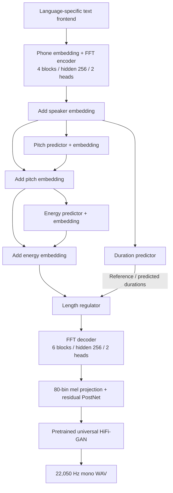

<a id="top"></a>

# FastSpeech 2 · English & Telugu

Two independent **FastSpeech 2** acoustic models generate English and Telugu mel spectrograms; a pretrained **universal HiFi-GAN** produces speech. The project adapts `ming024/FastSpeech2` for **Svarah English** and **IndicTTS Telugu**, following [FastSpeech2_Assignment.pdf](FastSpeech2_Assignment.pdf).

[](https://colab.research.google.com/github/SandeshAwate6055/FastSpeech2-English-Telugu/blob/main/FastSpeech2_Colab.ipynb)

| Important links | Open |
|---|---|
| **Colab pipeline** | [Run in Colab](https://colab.research.google.com/github/SandeshAwate6055/FastSpeech2-English-Telugu/blob/main/FastSpeech2_Colab.ipynb) · [Notebook source](FastSpeech2_Colab.ipynb) |
| **Main Drive: checkpoints & results** | [Shared artifact folder](https://drive.google.com/drive/folders/1WsR1NHhzpkLvk3V0g8X3Jy-xsXNlsYHf?usp=sharing) |
| **Technical report** | [20-page PDF](project/Report/Technical_Report.pdf) |
| **All ten WAVs** | [English audio](project/Results/English/test_generated_audios) · [Telugu audio](project/Results/Telugu/test_generated_audios) · [Individual samples](#audio) |
| **Results** | [English](project/Results/English) · [Telugu](project/Results/Telugu) |

## Navigate this README

> **Quick index: select a section to jump directly to it.**

1. **[Training graphs and results](#training-results)**
2. **[System architecture](#architecture)**
3. **[Test sentences, audio and variance plots](#audio)**
4. **[Datasets and training setup](#datasets)**
5. **[Checkpoint downloads](#checkpoints)**
6. **[Reproducibility and commands](#reproducibility)**
7. **[Technical report guide](#report)**
8. **[Code and references](#files)**
9. **[Assignment requirements and evidence](#assignment-map)**

<a id="training-results"></a>
## 1. Training graphs and results

**Submitted artifacts:** 10 WAVs, 30 variance plots and 4 loss figures. Both histories reach 60,000 steps; synthesis uses the best logged validation checkpoint for each language.

| English training | English validation |
|---|---|
|  |  |

| Telugu training | Telugu validation |
|---|---|
|  |  |

| Metric | English | Telugu |
|---|---:|---:|
| Selected checkpoint | **8,000** | **13,000** |
| Minimum validation total | **2.702820** | **1.965954** |
| Final validation total (60k) | 2.735320 | 1.979367 |
| Final sampled training total | 0.921556 | 0.662709 |
| Loss CSVs | [Train](project/Results/English/metrics/train_losses.csv) / [Validation](project/Results/English/metrics/val_losses.csv) | [Train](project/Results/Telugu/metrics/train_losses.csv) / [Validation](project/Results/Telugu/metrics/val_losses.csv) |

Validation improves early, then plateaus while training loss falls, consistent with overfitting. Lower loss across different corpora does not establish better speech quality. Detailed convergence analysis is in [report pages 5–8](project/Report/Technical_Report.pdf#page=5).

<a id="architecture"></a>
## 2. System architecture

English and Telugu use the same topology with **separate weights, phone inventories, speaker maps and statistics**. English uses lexicon/G2P phones; Telugu uses Unicode-based phone decomposition.



**Training** conditions the model on reference duration, pitch and energy; **inference** uses their predictions. Energy receives pitch-conditioned states, and both embeddings are added before duration expansion. [Model](project/English/model/fastspeech2.py) · [Variance adaptor](project/English/model/modules.py) · [Loss function](project/English/model/loss.py).

<a id="implementation"></a>
**Main adaptations:** separate corpus loaders/configurations, English lexicon plus `g2p_en` fallback, Telugu vowel/virama-aware phones and numeric expansion, speaker conditioning, alignment checks, training-only feature statistics, explicit checkpoint loading and prediction exports. This implementation uses phone-level F0/energy, a six-block decoder and HiFi-GAN; [report pages 2–3](project/Report/Technical_Report.pdf#page=2) explain the differences from the paper.

<a id="audio"></a>
<a id="variance-gallery"></a>
## 3. Test sentences, audio and variance plots

All WAVs are **22,050 Hz mono, 16-bit PCM**. Each row links to the audio and its three original predictor plots: **D** = duration, **F0** = pitch, **E** = energy. The supplied broken-word spacing in E3/T3 is preserved. Exact raw/normalized text and prediction arrays are available in the [English JSON](project/Results/English/variance_predictions_summary.json) and [Telugu JSON](project/Results/Telugu/variance_predictions_summary.json).

### English · step 8,000 · speaker 14

| ID | Assignment sentence | WAV / length | Plots |
|---|---|---|---|
| <a id="sample-e1"></a>**E1** | `The antidisestablishmentarianism movement gained considerable momentum during the parliamentary proceedings.` | [Play](https://raw.githubusercontent.com/SandeshAwate6055/FastSpeech2-English-Telugu/main/project/Results/English/test_generated_audios/E1.wav) / 5.817 s | [D](project/Results/English/variance_adaptor_plots/duration/E1_duration.png) · [F0](project/Results/English/variance_adaptor_plots/pitch/E1_pitch.png) · [E](project/Results/English/variance_adaptor_plots/energy/E1_energy.png) |
| <a id="sample-e2a"></a>**E2a** | `The orchestra's conduct during the ceremony was praised by the audience.` | [Play](https://raw.githubusercontent.com/SandeshAwate6055/FastSpeech2-English-Telugu/main/project/Results/English/test_generated_audios/E2a.wav) / 3.286 s | [D](project/Results/English/variance_adaptor_plots/duration/E2a_duration.png) · [F0](project/Results/English/variance_adaptor_plots/pitch/E2a_pitch.png) · [E](project/Results/English/variance_adaptor_plots/energy/E2a_energy.png) |
| <a id="sample-e2b"></a>**E2b** | `The researchers will conduct an experiment to evaluate the proposed method.` | [Play](https://raw.githubusercontent.com/SandeshAwate6055/FastSpeech2-English-Telugu/main/project/Results/English/test_generated_audios/E2b.wav) / 3.913 s | [D](project/Results/English/variance_adaptor_plots/duration/E2b_duration.png) · [F0](project/Results/English/variance_adaptor_plots/pitch/E2b_pitch.png) · [E](project/Results/English/variance_adaptor_plots/energy/E2b_energy.png) |
| <a id="sample-e3"></a>**E3** | `The rhyth  m of the orchestra changed unexpectedly.` | [Play](https://raw.githubusercontent.com/SandeshAwate6055/FastSpeech2-English-Telugu/main/project/Results/English/test_generated_audios/E3.wav) / 2.519 s | [D](project/Results/English/variance_adaptor_plots/duration/E3_duration.png) · [F0](project/Results/English/variance_adaptor_plots/pitch/E3_pitch.png) · [E](project/Results/English/variance_adaptor_plots/energy/E3_energy.png) |
| <a id="sample-e4"></a>**E4** | `The meeting will start at 10:45 AM on 12 November 2026, so andaroo should arrive on time.` | [Play](https://raw.githubusercontent.com/SandeshAwate6055/FastSpeech2-English-Telugu/main/project/Results/English/test_generated_audios/E4.wav) / 6.525 s | [D](project/Results/English/variance_adaptor_plots/duration/E4_duration.png) · [F0](project/Results/English/variance_adaptor_plots/pitch/E4_pitch.png) · [E](project/Results/English/variance_adaptor_plots/energy/E4_energy.png) |

### Telugu · step 13,000 · speaker 0

| ID | Assignment sentence | WAV / length | Plots |
|---|---|---|---|
| <a id="sample-t1"></a>**T1** | `న్యూరోఫార్మకోలాజికల్ పరిశోధనలో నూతన ఔషధాల ప్రభావాన్ని విశ్లేషించారు.` | [Play](https://raw.githubusercontent.com/SandeshAwate6055/FastSpeech2-English-Telugu/main/project/Results/Telugu/test_generated_audios/T1.wav) / 5.236 s | [D](project/Results/Telugu/variance_adaptor_plots/duration/T1_duration.png) · [F0](project/Results/Telugu/variance_adaptor_plots/pitch/T1_pitch.png) · [E](project/Results/Telugu/variance_adaptor_plots/energy/T1_energy.png) |
| <a id="sample-t2a"></a>**T2a** | `తాడుపై అతని పట్టు చాలా బలంగా ఉంది.` | [Play](https://raw.githubusercontent.com/SandeshAwate6055/FastSpeech2-English-Telugu/main/project/Results/Telugu/test_generated_audios/T2a.wav) / 2.577 s | [D](project/Results/Telugu/variance_adaptor_plots/duration/T2a_duration.png) · [F0](project/Results/Telugu/variance_adaptor_plots/pitch/T2a_pitch.png) · [E](project/Results/Telugu/variance_adaptor_plots/energy/T2a_energy.png) |
| <a id="sample-t2b"></a>**T2b** | `ఆమె పట్టు చీరను ధరించి వేడుకకు వచ్చింది.` | [Play](https://raw.githubusercontent.com/SandeshAwate6055/FastSpeech2-English-Telugu/main/project/Results/Telugu/test_generated_audios/T2b.wav) / 2.740 s | [D](project/Results/Telugu/variance_adaptor_plots/duration/T2b_duration.png) · [F0](project/Results/Telugu/variance_adaptor_plots/pitch/T2b_pitch.png) · [E](project/Results/Telugu/variance_adaptor_plots/energy/T2b_energy.png) |
| <a id="sample-t3"></a>**T3** | `పులి అడ  విలో నిశ్శబ్దంగా నడిచింది.` | [Play](https://raw.githubusercontent.com/SandeshAwate6055/FastSpeech2-English-Telugu/main/project/Results/Telugu/test_generated_audios/T3.wav) / 2.334 s | [D](project/Results/Telugu/variance_adaptor_plots/duration/T3_duration.png) · [F0](project/Results/Telugu/variance_adaptor_plots/pitch/T3_pitch.png) · [E](project/Results/Telugu/variance_adaptor_plots/energy/T3_energy.png) |
| <a id="sample-t4"></a>**T4** | `ఈ సమావేశం 2026 నవంబర్ 12వ తేదీ ఉదయం 10:45 గంటలకు ప్రారంభమవుతుంది, సమయానికి సిద్ధంగా ఉంచండి.` | [Play](https://raw.githubusercontent.com/SandeshAwate6055/FastSpeech2-English-Telugu/main/project/Results/Telugu/test_generated_audios/T4.wav) / 8.998 s | [D](project/Results/Telugu/variance_adaptor_plots/duration/T4_duration.png) · [F0](project/Results/Telugu/variance_adaptor_plots/pitch/T4_pitch.png) · [E](project/Results/Telugu/variance_adaptor_plots/energy/T4_energy.png) |

Per-sentence observations and measurements are in [report pages 9–18](project/Report/Technical_Report.pdf#page=9). Duration is measured in mel frames; F0 is an inverse-normalized phone prediction, not a generated-waveform F0 measurement; energy uses STFT-magnitude units. Human pronunciation/naturalness review remains pending.

<a id="datasets"></a>
## 4. Datasets and training setup

| Data | English | Telugu |
|---|---|---|
| Dataset | [ai4bharat/Svarah](https://huggingface.co/datasets/ai4bharat/Svarah) | [SPRINGLab/IndicTTS_Telugu](https://huggingface.co/datasets/SPRINGLab/IndicTTS_Telugu) |
| Retained training | 3,359 utterances / 5.000 h | 2,164 utterances / 5.000 h |
| Retained validation | 674 utterances / 1.001 h | 421 utterances / 1.000 h |
| Training groups/voices | 115 demographic profiles | 2 source voices |

Counts/hours are from recovered evidence summarized in [report page 4](project/Report/Technical_Report.pdf#page=4). Selection uses seed 42, 1–20 s clips, waveform deduplication and voice/profile-aware partitions with split-specific reserves. English profiles are not verified unique speaker identities.

**Preprocessing:** resample to 22,050 Hz, normalize transcripts, obtain compatible MFA phone alignments, then extract mel, duration, PyWorld F0 and energy features. Preserve interior pauses and fit normalization/bounds on selected training data only. Alignment is required before `preprocess.py`; its full process is documented in the report.

<a id="training-configuration"></a>
| Shared configuration | Value |
|---|---|
| Encoder / decoder | 4 / 6 FFT blocks; hidden 256; 2 heads |
| Variance heads | 256 channels; kernel 3; dropout 0.5; 256 pitch/energy bins |
| Features | 80 mel channels; FFT/window 1,024; hop 256; 0–8 kHz |
| Optimizer | Adam; betas (0.9, 0.98); epsilon 1e-9; batch 16; clipping 1.0 |
| Schedule | 4k warmup; 60k steps; anneal at 30k/45k/55k by 0.3 |
| Language configs | [English](project/English/config.yaml) · [Telugu](project/Telugu/config.yaml) |

<a id="split-integrity"></a>
<a id="limitations"></a>
**Evidence limits:** recovered manifests report zero ID overlap, but final audio hashes remain missing for 382 English and 339 Telugu reserve clips. The report also records 82 historical Telugu target/frontend mismatches. These and pending listening judgments are discussed on [page 19](project/Report/Technical_Report.pdf#page=19).

<a id="checkpoints"></a>
## 5. Checkpoint downloads

[Main Drive artifact folder](https://drive.google.com/drive/folders/1WsR1NHhzpkLvk3V0g8X3Jy-xsXNlsYHf?usp=sharing). The large acoustic weights are externally hosted; public download availability has not been revalidated in this documentation update.

| Model | Step / speaker | Download | Restore to |
|---|---|---|---|
| English | 8,000 / 14 | [8000.pth.tar](https://drive.google.com/uc?export=download&id=1asQbbLU4y9qPAHd8Jvu2T1G-5VES6X7P) | `project/English/checkpoints/8000.pth.tar` |
| Telugu | 13,000 / 0 | [13000.pth.tar](https://drive.google.com/uc?export=download&id=1loNuZ9gRVLTobXHzzwZGsDe8KkB_FB-p) | `project/Telugu/checkpoints/13000.pth.tar` |

SHA-256 checksums and sizes: [English checkpoint metadata](project/English/checkpoints/README.md) · [Telugu checkpoint metadata](project/Telugu/checkpoints/README.md). Restore each model's original `stats.json`, `speakers.json`, symbol/lexicon setup and `hifigan/generator_universal.pth.tar` together with its acoustic weights.

<a id="reproducibility"></a>
## 6. Reproducibility and commands

**Before running:** restore the omitted `project/tools/` helpers, matching model metadata and vocoder weights. Colab also references missing restoration/pipeline/probe scripts, `model_artifacts.json` and `Results/test_sentences.json`, and needs its root-level paths adjusted to `project/`. See [report page 20](project/Report/Technical_Report.pdf#page=20). These commands target a restored environment; fresh-clone GPU execution is not claimed.

```bash
git clone https://github.com/SandeshAwate6055/FastSpeech2-English-Telugu.git
cd FastSpeech2-English-Telugu
python -m pip install -r project/requirements.txt
python -c "import nltk; [nltk.download(n) for n in ['averaged_perceptron_tagger', 'averaged_perceptron_tagger_eng', 'cmudict']]"

# Generate the five English assignment samples.
cd project/English
python inference.py --config config.yaml \
  --ckpt_file checkpoints/8000.pth.tar --speaker_id 14 \
  --result_path ../Results/reproduced/English

# Generate the five Telugu assignment samples.
cd ../Telugu
python inference.py --config config.yaml \
  --ckpt_file checkpoints/13000.pth.tar --speaker_id 0 \
  --result_path ../Results/reproduced/Telugu
```

Omitting `--text` selects the built-in assignment sentences. Use new result directories to preserve the submitted outputs. Each language run writes five WAVs, fifteen plots and a prediction JSON.

For a new training run, execute the following independently from each language directory after restoring the helpers and choosing fresh experiment paths:

```bash
python prepare_data.py --train_hours 5.0 --val_hours 1.0 --seed 42
# Obtain compatible MFA phone TextGrids before the next step.
python preprocess.py --config config.yaml
# Validate features/provenance and held-out speech before full training.
python train.py --config config.yaml --total_step 60000
```

MFA is a separate training dependency. Svarah may require Hugging Face approval and `HF_TOKEN`. The requirements use lower version bounds rather than a complete historical environment lock.

<a id="report"></a>
## 7. Technical report guide

**[Open Technical_Report.pdf](project/Report/Technical_Report.pdf)** for the detailed demonstration and analysis.

| Topic | Pages |
|---|---|
| Architecture and language-specific changes | [2–3](project/Report/Technical_Report.pdf#page=2) |
| Data, preprocessing and configuration | [4](project/Report/Technical_Report.pdf#page=4) |
| English / Telugu loss analysis | [5–6](project/Report/Technical_Report.pdf#page=5) / [7–8](project/Report/Technical_Report.pdf#page=7) |
| English / Telugu sample analysis | [9–13](project/Report/Technical_Report.pdf#page=9) / [14–18](project/Report/Technical_Report.pdf#page=14) |
| Comparison, failures and improvements | [19](project/Report/Technical_Report.pdf#page=19) |
| Dependencies, commands and model links | [20](project/Report/Technical_Report.pdf#page=20) |

<a id="files"></a>
<a id="source-index"></a>
## 8. Code and references

```text
project/
├── English/    # prepare_data.py, preprocess.py, train.py, inference.py,
│               # config.yaml, checkpoints/, model/, text/, preprocessor/, ...
├── Telugu/     # independent language implementation and configuration
├── Results/
│   ├── English/ # loss figures, metrics/, test_generated_audios/, variance plots
│   └── Telugu/  # same result structure
├── Report/
│   └── Technical_Report.pdf
├── FastSpeech2_Colab.ipynb
├── README.md
└── requirements.txt
```

| Source | English | Telugu |
|---|---|---|
| Data preparation | [prepare_data.py](project/English/prepare_data.py) | [prepare_data.py](project/Telugu/prepare_data.py) |
| Feature extraction | [preprocess.py](project/English/preprocess.py) | [preprocess.py](project/Telugu/preprocess.py) |
| Training | [train.py](project/English/train.py) | [train.py](project/Telugu/train.py) |
| Test constants and synthesis | [inference.py](project/English/inference.py) | [inference.py](project/Telugu/inference.py) |
| Text frontend | [cleaners.py](project/English/text/cleaners.py) | [cleaners.py](project/Telugu/text/cleaners.py) |
| Acoustic model | [fastspeech2.py](project/English/model/fastspeech2.py) | [fastspeech2.py](project/Telugu/model/fastspeech2.py) |

<a id="references"></a>
References: [assignment specification](FastSpeech2_Assignment.pdf), [FastSpeech 2 paper](https://arxiv.org/abs/2006.04558), and [ming024/FastSpeech2](https://github.com/ming024/FastSpeech2) (report reference commit `d4e79eb`). Dataset links are in [Section 4](#datasets).

<a id="assignment-map"></a>
## 9. Assignment requirements and evidence

| No. | Requirement | Submission evidence | Status |
|---|---|---|---|
| 1 | Separate English and Telugu models | [English code](project/English) · [Telugu code](project/Telugu) · [Configurations](#training-configuration) | Present |
| 2 | About 5h train / 1h validation, with separate splits | [Dataset summary](#datasets) · [Report p. 4](project/Report/Technical_Report.pdf#page=4) | Counts reported; final hash audit incomplete |
| 3 | Trained checkpoints for both languages | [Downloads and restoration paths](#checkpoints) | External links supplied |
| 4 | Training and validation loss plots | [Four loss graphs and CSVs](#training-results) | Present |
| 5 | Five test WAVs per language | [Ten exact test inputs and audio links](#audio) | Present |
| 6 | Duration, F0 and energy plots for every sample | [Thirty plot links](#variance-gallery) | Present |
| 7 | Detailed technical report | [20-page PDF](project/Report/Technical_Report.pdf) | Present; listening judgments pending |
| 8 | Required project structure and public evaluation artifacts | [Folder structure](#files) · [GitHub repository](https://github.com/SandeshAwate6055/FastSpeech2-English-Telugu) | Present |
| 9 | Preprocessing, training and inference instructions | [Commands and prerequisites](#reproducibility) | Documented; runtime restoration required |

[Back to top](#top) · [Main Drive](https://drive.google.com/drive/folders/1WsR1NHhzpkLvk3V0g8X3Jy-xsXNlsYHf?usp=sharing) · [Technical report](project/Report/Technical_Report.pdf)

