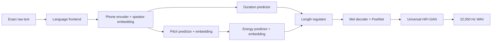
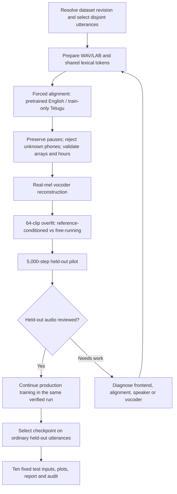

<div align="center">

# FastSpeech 2 ? English & Telugu

**Two independent acoustic models with duration, pitch and energy prediction**

[Read the 20-page report](Report/Technical_Report.pdf) ? [Open in Colab](https://colab.research.google.com/github/SandeshAwate6055/FastSpeech2-English-Telugu/blob/main/notebooks/FastSpeech2_Colab.ipynb) ? [Explore results](#listen-and-inspect) ? [Download models](#models-and-metadata)

</div>

> **Current evidence:** 10 WAVs, 30 variance plots, 4 loss curves and both selected local checkpoint hashes pass structural checks. Listening observations and complete retained-reserve audio hashes are still pending. See the [live audit record](Results/submission_audit.json) and [requirement matrix](SUBMISSION_STATUS.md). Code fixes in this revision have not retrained the saved models.

[Overview](#overview) ? [Quickstart](#quickstart) ? [Results](#listen-and-inspect) ? [Models](#models-and-metadata) ? [Data](#data-and-training) ? [Structure](#assignment-folder-structure) ? [Reproducibility](#checks-and-report-generation)

## Overview

This assignment adapts [ming024/FastSpeech2](https://github.com/ming024/FastSpeech2/tree/d4e79eb52e8b01d24703b2dfc0385544092958f3) for **English using Svarah** and **Telugu using IndicTTS Telugu**. Models are trained separately with approximately five hours of training and one hour of validation audio per language. A pretrained universal HiFi-GAN converts 80-bin mel predictions into 22,050 Hz mono speech.

The implementation follows the supplied *FastSpeech2_Assignment.pdf*. The repository root is the assignment's `project/` directory; no additional nested `project/` folder is needed. The [status matrix](SUBMISSION_STATUS.md) maps the requirements to exact files and identifies remaining evidence gaps.



Training supplies reference duration/F0/energy; final synthesis predicts all three. The baseline uses four encoder and six decoder FFT blocks, hidden size 256, two heads and phone-level variance targets. This is a documented adaptation: paper v8 uses frame-level CWT pitch, frame-level energy, a four-block decoder and Parallel WaveGAN. See [CHANGES.md](CHANGES.md).

## Quickstart

### 1. Get the project and dependencies

```bash
git clone https://github.com/SandeshAwate6055/FastSpeech2-English-Telugu.git
cd FastSpeech2-English-Telugu
python -m pip install -r requirements.txt
python -c "import nltk; [nltk.download(n) for n in ['averaged_perceptron_tagger', 'averaged_perceptron_tagger_eng', 'cmudict']]"
```

Use a compatible Python/PyTorch environment; Colab provides a convenient GPU runtime. Requirements specify lower bounds, not a recovered lock of the historical training environment. New runs record installed versions and resolved dataset revisions. MFA runs in a separate environment.

### 2. Restore the selected inference bundles

```bash
python tools/restore_artifacts.py --download
```

This verifies the published metadata bundle and downloads missing checkpoint/vocoder weights with SHA-256 checks. If Drive returns a confirmation/login page, download the checkpoints using the links below and place them at the documented paths. Then rerun the command. Existing files with different checksums are preserved and cause an error.

`python tools/restore_artifacts.py` restores small metadata and verifies weights that are already present. It does not download missing weights without `--download`.

### 3. Generate all ten required inputs

Run these commands from the repository root. Configuration paths resolve relative to each YAML file; explicit CLI paths resolve from the current shell directory.

```bash
python English/inference.py --config English/config.yaml --ckpt_file English/checkpoints/8000.pth.tar --speaker_id 14 --result_path experiments/review/English
python Telugu/inference.py --config Telugu/config.yaml --ckpt_file Telugu/checkpoints/13000.pth.tar --speaker_id 0 --result_path experiments/review/Telugu
```

Each command generates five WAVs, fifteen variance plots and one prediction JSON in the chosen result directory. New output directories preserve the committed assignment results. Inference rejects missing checkpoint files and unknown speaker IDs.

## Listen and inspect

GitHub provides the navigation, expandable sections and Mermaid diagrams below. For **audio controls, language filtering, plot switching and editable listening notes**, open [Report/audio_review.html](Report/audio_review.html) locally after cloning. GitHub displays the HTML source rather than running this tool.

```bash
python -m http.server 8000 --bind 127.0.0.1
```

Then open **http://127.0.0.1:8000/Report/audio_review.html**. Notes stay in your browser until exported. Replace `Results/listening_review.json` with the exported file and rebuild the report. Use a Telugu-proficient reviewer for T1?T4; a completed review may honestly describe poor speech.

| Input | Model | Audio | Variance adaptor predictions |
|---|---|---|---|
| E1 | English | [Listen/download](Results/English/test_generated_audios/E1.wav) | [Duration](Results/English/variance_adaptor_plots/duration/E1_duration.png) ? [F0](Results/English/variance_adaptor_plots/pitch/E1_pitch.png) ? [Energy](Results/English/variance_adaptor_plots/energy/E1_energy.png) |
| E2a | English | [Listen/download](Results/English/test_generated_audios/E2a.wav) | [Duration](Results/English/variance_adaptor_plots/duration/E2a_duration.png) ? [F0](Results/English/variance_adaptor_plots/pitch/E2a_pitch.png) ? [Energy](Results/English/variance_adaptor_plots/energy/E2a_energy.png) |
| E2b | English | [Listen/download](Results/English/test_generated_audios/E2b.wav) | [Duration](Results/English/variance_adaptor_plots/duration/E2b_duration.png) ? [F0](Results/English/variance_adaptor_plots/pitch/E2b_pitch.png) ? [Energy](Results/English/variance_adaptor_plots/energy/E2b_energy.png) |
| E3 | English | [Listen/download](Results/English/test_generated_audios/E3.wav) | [Duration](Results/English/variance_adaptor_plots/duration/E3_duration.png) ? [F0](Results/English/variance_adaptor_plots/pitch/E3_pitch.png) ? [Energy](Results/English/variance_adaptor_plots/energy/E3_energy.png) |
| E4 | English | [Listen/download](Results/English/test_generated_audios/E4.wav) | [Duration](Results/English/variance_adaptor_plots/duration/E4_duration.png) ? [F0](Results/English/variance_adaptor_plots/pitch/E4_pitch.png) ? [Energy](Results/English/variance_adaptor_plots/energy/E4_energy.png) |
| T1 | Telugu | [Listen/download](Results/Telugu/test_generated_audios/T1.wav) | [Duration](Results/Telugu/variance_adaptor_plots/duration/T1_duration.png) ? [F0](Results/Telugu/variance_adaptor_plots/pitch/T1_pitch.png) ? [Energy](Results/Telugu/variance_adaptor_plots/energy/T1_energy.png) |
| T2a | Telugu | [Listen/download](Results/Telugu/test_generated_audios/T2a.wav) | [Duration](Results/Telugu/variance_adaptor_plots/duration/T2a_duration.png) ? [F0](Results/Telugu/variance_adaptor_plots/pitch/T2a_pitch.png) ? [Energy](Results/Telugu/variance_adaptor_plots/energy/T2a_energy.png) |
| T2b | Telugu | [Listen/download](Results/Telugu/test_generated_audios/T2b.wav) | [Duration](Results/Telugu/variance_adaptor_plots/duration/T2b_duration.png) ? [F0](Results/Telugu/variance_adaptor_plots/pitch/T2b_pitch.png) ? [Energy](Results/Telugu/variance_adaptor_plots/energy/T2b_energy.png) |
| T3 | Telugu | [Listen/download](Results/Telugu/test_generated_audios/T3.wav) | [Duration](Results/Telugu/variance_adaptor_plots/duration/T3_duration.png) ? [F0](Results/Telugu/variance_adaptor_plots/pitch/T3_pitch.png) ? [Energy](Results/Telugu/variance_adaptor_plots/energy/T3_energy.png) |
| T4 | Telugu | [Listen/download](Results/Telugu/test_generated_audios/T4.wav) | [Duration](Results/Telugu/variance_adaptor_plots/duration/T4_duration.png) ? [F0](Results/Telugu/variance_adaptor_plots/pitch/T4_pitch.png) ? [Energy](Results/Telugu/variance_adaptor_plots/energy/T4_energy.png) |

<details>
<summary><strong>Exact mandatory sentences ? original text and intentional spacing</strong></summary>

The [frozen UTF-8 manifest](Results/test_sentences.json) was checked against the supplied PDF's visual text. Raw inputs and normalized pronunciation text are stored separately. E3/T3 double spaces are intentional. The required test inputs are never used as training examples or to select checkpoints.

```text
English
E1: The antidisestablishmentarianism movement gained considerable momentum during the parliamentary proceedings.
E2a: The orchestra's conduct during the ceremony was praised by the audience.
E2b: The researchers will conduct an experiment to evaluate the proposed method.
E3: The rhyth  m of the orchestra changed unexpectedly.
E4: The meeting will start at 10:45 AM on 12 November 2026, so andaroo should arrive on time.
```

```text
Telugu
T1: న్యూరోఫార్మకోలాజికల్ పరిశోధనలో నూతన ఔషధాల ప్రభావాన్ని విశ్లేషించారు.
T2a: తాడుపై అతని పట్టు చాలా బలంగా ఉంది.
T2b: ఆమె పట్టు చీరను ధరించి వేడుకకు వచ్చింది.
T3: పులి అడ  విలో నిశ్శబ్దంగా నడిచింది.
T4: ఈ సమావేశం 2026 నవంబర్ 12వ తేదీ ఉదయం 10:45 గంటలకు ప్రారంభమవుతుంది, సమయానికి సిద్ధంగా ఉంచండి.
```

</details>

<details>
<summary><strong>Loss curves and checkpoint selection</strong></summary>

| Language | Audio step / speaker | Lowest logged validation total | Validation at 60k | Training at 60k |
|---|---|---:|---:|---:|
| English | 8,000 / 14 | 2.702820 | 2.735320 | 0.921556 |
| Telugu | 13,000 / 0 | 1.965954 | 1.979367 | 0.662709 |

The preserved CSVs contain 600 sampled training entries and 60 aggregate validation entries per model. The selected steps coincide with validation minima. A lower loss or a later checkpoint does not guarantee intelligible speech, and losses across corpora are not naturalness scores.

**English** ? [Training PNG](Results/English/training_loss.png) ? [Validation PNG](Results/English/validation_loss.png) ? [Source CSVs](Results/English/metrics/)


**Telugu** ? [Training PNG](Results/Telugu/training_loss.png) ? [Validation PNG](Results/Telugu/validation_loss.png) ? [Source CSVs](Results/Telugu/metrics/)


</details>

<details>
<summary><strong>How to interpret duration, F0 and energy</strong></summary>

- Duration is the integer number of mel frames used for token expansion. One frame is 256/22,050 seconds, approximately 11.61 ms. Zero duration removes a token from expansion.
- F0 is the inverse-normalized continuous phone-level prediction in Hz. Training interpolation includes unvoiced regions; this is not a voiced-only measurement of generated speech.
- Energy is the inverse-normalized L2 norm of STFT magnitudes. It is not dB SPL.
- Predictor curves and waveform spectrograms can reveal timing/acoustic patterns. Pronunciation and intelligibility require listening to the corresponding WAV.

</details>

## Models and metadata

External checkpoint hosting follows the assignment's allowance for files larger than GitHub's limits. [Artifact registry](model_artifacts.json) contains byte sizes, hashes, source archive links and metadata paths. [Owner-supplied Drive folder](https://drive.google.com/drive/folders/1WsR1NHhzpkLvk3V0g8X3Jy-xsXNlsYHf?usp=sharing).

| Language | Selected weights | Destination | Inference metadata |
|---|---|---|---|
| English | [Step 8,000](https://drive.google.com/uc?export=download&id=1asQbbLU4y9qPAHd8Jvu2T1G-5VES6X7P) | `English/checkpoints/8000.pth.tar` | [Metadata](Results/English/metadata/) |
| Telugu | [Step 13,000](https://drive.google.com/uc?export=download&id=1loNuZ9gRVLTobXHzzwZGsDe8KkB_FB-p) | `Telugu/checkpoints/13000.pth.tar` | [Metadata](Results/Telugu/metadata/) |

The local selected checkpoint hashes match the registry. Live Drive accessibility was not reverified in this revision. Metadata, configs, symbol/frontend snapshots and pronunciation dictionaries are published under `Results/<Language>/metadata/`; they are checksum-inventoried. A recovered source snapshot is not proof of the actual training commit. Full source corpora remain subject to their dataset access terms.

## Data and training

| Stage | English: Svarah | Telugu: IndicTTS Telugu |
|---|---|---|
| Primary selection before alignment | 3,091 train / 625 val; 5.001h / 1.000h | 1,902 train / 361 val; 5.002h / 1.004h |
| Reserves before alignment | 446 train / 116 val | 290 train / 84 val |
| Recovered retained summary | 3,359 train / 674 val; 5.000h / 1.001h | 2,164 train / 421 val; 5.000h / 1.000h |
| Speaker handling | 115 demographic profiles; 114 in validation | Two studio voices, both in training/validation |
| Final ID overlap | 0 | 0 |
| Missing final audio hashes | 382 retained reserve clips | 339 retained reserve clips |

Raw durations and aligned/trimmed durations differ. Primary/reserve counts describe preparation; retained counts describe preprocessing. The published selected manifests confirm ID separation and trained-speaker coverage. Preparation statistics report zero audio-hash overlap, but missing reserve hashes prevent independently confirming full final waveform disjointness. English demographic profiles must not be equated with verified individual identities.

`audio_sha1` identifies the resampled, peak-normalized, signed 16-bit PCM sample bytes used by preparation, excluding the WAV header. New feature validation rehashes those actual WAV samples against every selected source-manifest entry.



### Run a fresh experiment in Colab

Open the [notebook](https://colab.research.google.com/github/SandeshAwate6055/FastSpeech2-English-Telugu/blob/main/notebooks/FastSpeech2_Colab.ipynb) and set `MODE = "train"`. Choose a **new** `RUN` directory. The default `MODE = "evaluate"` restores the submitted models instead.

Fresh training regenerates audio and alignments, validates all selected arrays, preserves all four source manifests and hashes the feature/source/configuration bundle. English requires prior Svarah approval and `HF_TOKEN` in Colab Secrets. Telugu's acoustic aligner is trained only on training/reserve-training audio. Each language must pass the vocoder/overfit and held-out pilot listening gates before production training.

<details>
<summary><strong>Training commands after preparation and validation</strong></summary>

The notebook prepares isolated absolute-path configurations and a separate MFA environment. Its orchestration can also be invoked from a Linux/Colab shell after installing MFA's micromamba environment as shown in section 1:

```bash
python tools/colab_pipeline.py prepare English --run-dir /content/drive/MyDrive/NEW_RUN
python tools/colab_pipeline.py prepare Telugu --run-dir /content/drive/MyDrive/NEW_RUN
python tools/colab_pipeline.py overfit English --run-dir /content/drive/MyDrive/NEW_RUN
python tools/colab_pipeline.py overfit Telugu --run-dir /content/drive/MyDrive/NEW_RUN
```

The scripts produce `/content/drive/MyDrive/NEW_RUN/<Language>/config.yaml`. For example, after reviewing diagnostic audio:

```bash
python English/train.py --config /content/drive/MyDrive/NEW_RUN/English/config.yaml --total_step 5000 --val_step 1000 --save_step 1000
```

Resume a matching pilot only after reviewing held-out speech:

```bash
python English/train.py --config /content/drive/MyDrive/NEW_RUN/English/config.yaml --restore_step 5000 --total_step 60000 --val_step 1000 --save_step 1000
```

Use the corresponding Telugu path for its independent model. Resume refuses changed feature bytes, frontend, model or optimizer settings. Historical checkpoints without this provenance remain available for inference; they cannot silently enter a new corrected training run.

</details>

### Known failure and current fixes

The earlier pipeline omitted empty interior MFA intervals while retaining the corresponding waveform pauses. Targets after a pause could therefore shift onto the wrong audio. Current preprocessing preserves these intervals and verifies full timeline/frame consistency before slicing.

The code review also found 82 historical Telugu target/frontend mismatches, often around dotted initials. [Diagnostic evidence](Results/frontend_audit.json). New preparation uses shared word tokenization and preprocessing rejects unknown-speech `spn` rather than treating it as silence. These repairs require new alignment/training to affect the existing model's learned behavior.

## Assignment folder structure

```text
project/                         repository root
??? English/
?   ??? train.py
?   ??? preprocess.py
?   ??? inference.py
?   ??? config.yaml
?   ??? checkpoints/             selected English weight file or documented external link
??? Telugu/
?   ??? train.py
?   ??? preprocess.py
?   ??? inference.py
?   ??? config.yaml
?   ??? checkpoints/             selected Telugu weight file or documented external link
??? Results/
?   ??? English/
?   ?   ??? training_loss.png
?   ?   ??? validation_loss.png
?   ?   ??? test_generated_audios/
?   ?   ??? variance_adaptor_plots/{duration,pitch,energy}/
?   ??? Telugu/
?       ??? training_loss.png
?       ??? validation_loss.png
?       ??? test_generated_audios/
?       ??? variance_adaptor_plots/{duration,pitch,energy}/
??? Report/
?   ??? Technical_Report.pdf
??? README.md
??? requirements.txt
```

### Clearly identified supporting additions

The required paths above remain intact. The following additions support implementation, evidence and reproduction:

| Addition | Purpose |
|---|---|
| `English/prepare_data.py`, `Telugu/prepare_data.py` | Dataset selection, audio preparation and MFA lexicons |
| Language `audio/`, `model/`, `text/`, `transformer/`, `preprocessor/`, `utils/`, `hifigan/` | Reference-derived implementation modules and vocoder code |
| Language `checkpoints/README.md` | Exact download location and checksum for each large weight file |
| `Results/<Language>/metrics/` | Original training and validation CSV histories |
| `Results/<Language>/metadata/` | Published statistics, speaker maps, selected ID/hash manifests and recovered source snapshots |
| `Results/<Language>/variance_predictions_summary.json` | Exact input, normalized text, tokens, predicted arrays, step and speaker |
| `Results/test_sentences.json`, `listening_review.json`, `frontend_audit.json`, `submission_audit.json` | Frozen inputs, human observations, historical phone comparison and machine checks |
| `Report/audio_review.html` | Local interactive player, plot explorer and review export |
| `Report/generate_report.py`, `figures.py`, `render_report.py`, `requirements.txt` | Rebuild the report, diagrams, measured spectrograms and page previews |
| `notebooks/FastSpeech2_Colab.ipynb` | Eight-section evaluation or gated fresh-training workflow |
| `tools/run_support.py`, `restore_artifacts.py` | Relative paths, checksums, restoration and experiment provenance |
| `tools/colab_pipeline.py`, `validate_features.py`, `probe_audio.py` | Fresh alignment orchestration, feature checks and audio diagnostics |
| `tools/audit_submission.py`, `audit_evidence.py`, `audit_frontend.py` | Structural, evidence and historical frontend audits |
| `tools/export_evidence.py`, `build_review_page.py` | Export recovered evidence and rebuild the local reviewer |
| `tools/tests/` | Regression checks for checkpoint, provenance, frontend and audit failures |
| `model_artifacts.json`, `SUBMISSION_STATUS.md`, `CHANGES.md` | Model registry, requirement matrix and implementation changes |

`raw_data/`, feature arrays, large weights, temporary experiments and PDF previews are local/generated files, excluded from Git. Public metadata is kept under Results so a fresh clone can inspect the evidence without private local folders.

## Checks and report generation

```bash
python tools/audit_submission.py --output Results/submission_audit.json
python tools/audit_submission.py --strict
python -m unittest discover -s tools/tests -v
python -m pip install -r Report/requirements.txt
python tools/build_review_page.py
python Report/generate_report.py
python Report/render_report.py
```

Normal audit mode checks structural and numerical consistency. Strict mode additionally fails on missing required evidence or listening observations. Its current failures are documented, not hidden. Live external accessibility is separate from local hash verification.

The report is constrained to **20 pages** and includes the architecture, language changes, dataset/training protocol, both loss analyses, ten sentence analyses, comparison and reproduction links. Every sentence includes predictor plots, generated-waveform measurements and a spectrogram. Listening observations are included only when a matching WAV-hash review exists.

On Windows, Telugu report text uses Nirmala UI through the native renderer. On Linux, install a Telugu font and use Pillow with libraqm; set `TELUGU_FONT` to its path. Full-size page previews are generated locally under ignored `Report/preview/`.

## References

- [FastSpeech 2 research paper, v8](https://arxiv.org/abs/2006.04558v8)
- [Reference implementation at the assignment baseline](https://github.com/ming024/FastSpeech2/tree/d4e79eb52e8b01d24703b2dfc0385544092958f3)
- [English: ai4bharat/Svarah](https://huggingface.co/datasets/ai4bharat/Svarah)
- [Telugu: SPRINGLab/IndicTTS_Telugu](https://huggingface.co/datasets/SPRINGLab/IndicTTS_Telugu)
- [HiFi-GAN reference source](https://github.com/jik876/hifi-gan)
